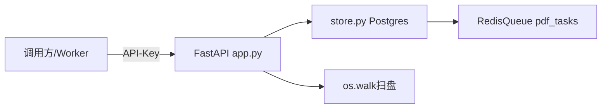

# 系统API与模块接口设计说明书（基于真实源码反向梳理 v1.0）

> 范围：`backend/app.py::build_app` 8个真实路由 + `backend/store.py` + `scheduler/queue.py` + Parser→Classifier交接。未虚构接口。契约优先于旧文档。

## 1 接口设计概述

API在本系统只做三件事：收单（scan）、查改（results/review/taxonomy）、入库（POST /results供Worker回写）。解析分类全在Worker里，不在HTTP里。

三类接口区别：HTTP同步查改（FastAPI+Pydantic+API-Key）、Python内部调用（函数签名，Parser/Classifier/Scheduler直调）、Redis异步投递（`RedisQueue rpush/blpop pdf_tasks` + `seen去重`，Windows用`FakeQueue`内存替身）。

认证：`backend/auth.py require_key`，全路由`Depends(require_key)`，`API_KEY`环境变量，缺失/错误→401。输入输出：`schemas.ScanRequest{root,limit≤100000}`、`ReviewPatch{reviewer必填}`，错误统一`HTTPException(400/404)`。

## 2 HTTP API总览（8个真实路由）

| # | Method | URL | 功能 | 调用方 |
|---|---|---|---|---|
| 1 | POST | /tasks/scan | 扫目录建任务，幂等 | 运维/调度 |
| 2 | GET | /tasks/{task_id} | 任务状态 | 前端/运维 |
| 3 | GET | /results | 结果分页筛选 | 前端 |
| 4 | GET | /results/{rid} | 结果详情 | 前端/复核 |
| 5 | POST | /results | Worker回写入库 | classify-worker |
| 6 | GET | /review/queue | 待复核队列 | 复核员 |
| 7 | POST | /review/{rid} | 复核回写 | 复核员 |
| 8 | GET | /taxonomy | 知识库版本 | 前端 |

契约差异：`contracts/api-contract.yaml`有`POST /results/export`，代码未实现（以代码为准）。

## 3 各API详细设计

### 3.1 POST /tasks/scan（202受理）
功能：`os.walk(root)`找`.pdf`（`limit`截断）→`store.create_task`逐个幂等建单→回`accepted+task_ids`。不等解析。
请求：`{"root":"/data/pdfs","limit":1000}`。响应：`{"accepted":2,"task_ids":[...]}`。状态：202成功；400 root非目录；401鉴权。代码：`backend/app.py::scan`→`store.create_task`（`uuid5(path:hash)`查有返旧）。

### 3.2 GET /tasks/{task_id}（无请求体）
回`{task_id,file_path,stage,status,retry_count,error_code,error_msg}`。404任务不存在。代码：`app.py::task_status`→`store.get_task`。

### 3.3 GET /results?page&size&result_type&level1（无请求体）
分页`page≥1,size1-200`，可选`result_type/level1`。回`{total,page,size,items:[{id,result_type,level1,level2,file_path}]}`。代码：`store.query_results`按`id desc`。

### 3.4 GET /results/{rid}（无请求体）
详情含`candidate_scores/decision_source/classification_basis/model_version/taxonomy_version`。404结果不存在。

### 3.5 POST /results（201）
Worker分类完回写。请求即`ClassificationResult`载荷（见§5）。`save_result`校验：`result_type∈5态`；`CLASSIFIED必须L1+L2`；`非CLASSIFIED带L1/L2→400`。成功201`{id}`。失败400。代码：`app.py::ingest`→`store.save_result`（同时`UPDATE tasks SAVE/DONE`）。

### 3.6 GET /review/queue?page&size（无请求体）
只查`result_type=MANUAL_REVIEW AND reviewed_by IS NULL`。注意：`UNRESOLVED`不在此队列（遗留差异，复核需查`/results?result_type=UNRESOLVED`）。

### 3.7 POST /review/{rid}
请求：`{"reviewer":"zhang","level1":"L1_FZZJ","level2":"L2_SLFH","note":""}`，`reviewer必填`。仅`MANUAL_REVIEW`可改，否则404。回`{id,reviewed_by}`。代码：`store.apply_review`。

### 3.8 GET /taxonomy（无请求体）
回`{taxonomy_version:"v1.0-planner",level1:[4个id],l2_counts:{...}}`。代码：`classifier/knowledge.load_taxonomy("contracts/taxonomy.yaml")`。4一级25二级（7+3+9+6）。

## 4 模块内部接口

Parser→Classifier：`parser/parser.py::parse→dict{file_path,pdf_type,title,headings,pages:[{page_no,text,ocr_score}],evidence_mode,visual_description}`→`classifier/pipeline.ClassificationPipeline.run(parse)→result dict`。文件传递只传`file_path`（只读挂载），不传二进制。

Scheduler↔Worker：`Pipeline.run_one(task_id,file_path)`：`parse_fn→classify_fn→save_fn`，异常按`RETRYABLE+MAX_RETRIES=3`置RETRY否则DEAD（内存版；DB版见§6）。

Redis消息：`RedisQueue.enqueue(task_id,payload)→sadd seen判重+rpush pdf_tasks {task_id,payload}`；`dequeue→blpop timeout=1`；`to_dead→rpush pdf_tasks:dead`。`FakeQueue`同语义（deque+seen set）。

持久化：`store.save_result(payload)`→`INSERT classification_results`+`UPDATE doc_tasks SAVE`同一事务。

函数签名：`create_task(db,path)→DocTask`；`save_result(db,payload)→ClassificationResult`；`route_evidence(parse,th)→{mode,bundle,query_text}`；`gate(q,l1_desc,emb,th)`；`classify_l1/l2(...)`；`AutoReviewer.review(...)`；`verify(q,l2info,children)`。

## 5 核心数据结构

`ParseResult{file_path,pdf_type:TEXT/SCAN/COMPLEX/IMAGE,MODE,title,headings[5],pages[{text,ocr_score}],evidence_mode}`；`EvidencePackage{mode:TITLE/BODY/OCR_BODY/VISION,bundle{title,headings,paras[{text,page_no}],visual},query_text≤max_chars,has_title}`；`ClassificationResult{id,task_id,file_path,file_hash,result_type:5态,relevance_status,evidence_mode,level1,level2,candidate_scores{gate,l2,margin},decision_source:RULE/BGE/RERANKER/LLM/MANUAL/HUMAN,classification_basis{mode,title,paras[:3],visual},model/taxonomy/prompt_version,retry_count,error,reviewed_*}`。字段含义：`file_path`原地址跟一辈子；`candidate_scores`留痕；`taxonomy_version`回溯判错版本。

## 6 状态机与异常

任务态（`doc_tasks.status`）：`PENDING→RUNNING→DONE/REVIEW`，`stage:SCAN/TYPE/PARSE/EVIDENCE/GATE/L1/L2/VERIFY/SAVE`。结果态（`results.result_type`）：`CLASSIFIED/IRRELEVANT/MANUAL_REVIEW/UNRESOLVED/FAILED`。`UNRESOLVED`=verify两次不过非故障必人看；`MANUAL`=阈值未校准/分差小/LLM弃权；`FAILED`=embedding炸可重试。幂等：`file_hash唯一索引+uuid5`，重扫返旧。重试：`scheduler/pipeline MAX_RETRIES=3`。未实现：`POST /results/export`、`UNRESOLVED复核队列`、`review UNRESOLVED`（`apply_review`仅MANUAL）。
