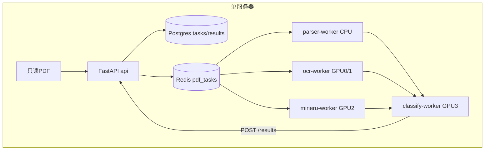

# 系统代码架构与模块设计说明书（基于真实源码反向梳理 v1.0）

> 业务：900万PDF（约9000万页）按4一级25二级（`taxonomy.yaml v1.0`）判单标签。单Linux GPU服务器+Docker Compose多Worker，非集群。思想：按需分流、证据瘦身、漏斗召回、疑难二审、阈值门禁。

## 1 系统概述
目标：文本50%秒拆、扫描35% OCR、复杂10% MinerU、纯图Vision兜底；无关早退；低分进MANUAL/UNRESOLVED。约束：单机4×48G GPU（0/1 OCR、2 MinerU、3 BGE/Reranker/LLM）、Postgres+Redis同机。分类固定4一级（安全生产/应急救援/综合管理/防灾减灾）25二级。

## 2 总体架构



FastAPI收单查改；Postgres记账存证；Redis削峰分活；Worker按卡分工。依赖：Worker→Redis/Postgres/API；Classifier→Parser的ParsedDoc；全员读taxonomy。

## 3 代码结构

```
backend/{app.py门面8路由,store.py事务+门禁,models.py DocTask/ClassificationResult,schemas.py,auth.py}/migrations/001_init.sql
parser/{detector.py,router.py,parser.py,models.py,pymupdf_extractor.py,ocr_paddle.py,mineru_adapter.py,vision_stub.py}
classifier/{pipeline.py总导演,evidence.py,gate.py,levels.py,review.py二审,verify.py,knowledge.py,config.py阈值,backends.py/interfaces.py}
scheduler/{pipeline.py STAGES+重试,queue.py Redis/Fake,resources.py gpu_lock.py handoff.py benchmark.py}
deploy/{docker-compose.yml 8服务,Dockerfile.api/ocr/mineru/infer,worker_main.py,prometheus.yml}
contracts/{taxonomy.yaml,architecture.md,api-contract.yaml,data-contract.md,state-machine.md}
tests/{test_parser,classification,backend,scheduler,deploy,integration}
```

## 4 核心模块设计

**Parser**（为啥：抹平三路差异）：入`file_path`出`ParsedDoc`；`detector`看前3页定TEXT/SCAN/COMPLEX/IMAGE；`router`定evidence_mode；异常OCR低分标vision待补。调`classifier.evidence`。位置见§3。

**Classifier**（为啥：省钱准判）：入ParsedDoc出5态result；`evidence→gate→L1→L2→review→verify→_auto`；`interfaces`三插座换模型不改流程。依赖knowledge/config/backends。

**Backend**（为啥：只存查不算）：入HTTP出DB行；`create_task uuid5幂等`；`save_result非CLASSIFIED带类→400`；异常400/404。依赖models/store。

**Scheduler**（为啥：不断不重）：入task_id出DONE/RETRY/DEAD；`STAGES 9步`+`MAX_RETRIES=3`+`seen去重+handoff断点`。依赖queue/resources。

**Deploy**（为啥：隔卡隔离）：`postgres/redis/api/parser/ocr×2/mineru/classify/prometheus`；`PDF_ROOT:ro`原文件不动；`GPU_VISIBLE_DEVICES`分房。未在真机验证。

## 5 分类引擎专项（非全走LLM）

`detector→PyMuPDF直提(TEXT)/PaddleOCR(SCAN)/MinerU(COMPLEX)→route_evidence四态(TITLE2段/BODY8段/OCR/VISION)→gate(BGE>0.7要/<0.3弃/中UNCERTAIN戴帽)→L1规则命中直定否则BGE→L2 BGE Top5→Reranker→LLM Top3→review(L1空/L2空/verify挂补3-6段两轮)→verify大小归属→_auto(calibrated=False全降MANUAL)→IRRELEVANT早结/UNRESOLVED疑难/FAILED可重试`。LLM只在判不出/分差小/质检挂时触发。

## 6 运行流程

扫盘→`create_task`→`rpush pdf_tasks`→`blpop`领活→`parse_fn`→`classify_fn`→`POST /results save`→`GET /results|review`查改。时序：前端→API→DB→Redis→Parser→Classifier→API→DB→前端。分支图见API文档§6。Worker挂只重跑当前stage。

## 7 部署可靠性
单机Compose；CPU parser可`--scale`；GPU按卡预留；Redis持久化+AOF；Postgres卷+init.sql；`file_hash唯一`幂等；`seen`防重投；`stage`断点续跑；prometheus+dcgm-exporter监控（profile默认不启）。

## 8 实现状态
已实现：8 HTTP路由、2表+门禁、Parser分流、Classifier全链+二审+UNRESOLVED、Fake/Redis双队列、Compose编排。Mock测试通过（pytest+FakeEmb/LLM）。真实CPU抽测部分通过。真实GPU未验证（Paddle/MinerU/BGE/Reranker待真卡）。待部署（compose未在服务器up）。待校准（`calibrated=False`默认全MANUAL，需1万标注调阈值）。差异：缺`POST /export`、缺UNRESOLVED队列、review仅MANUAL。
