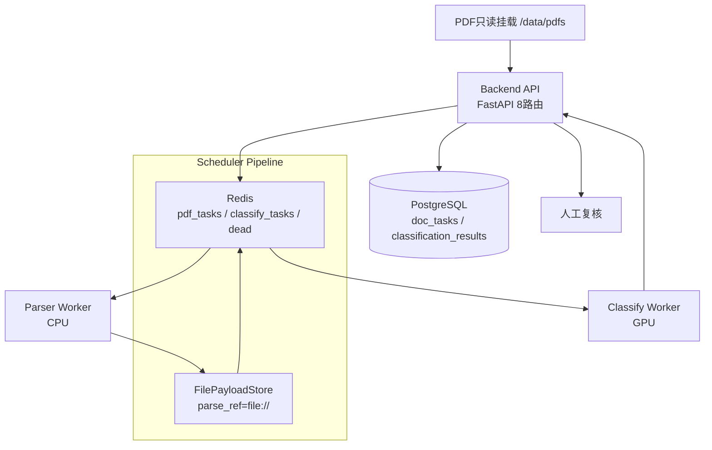
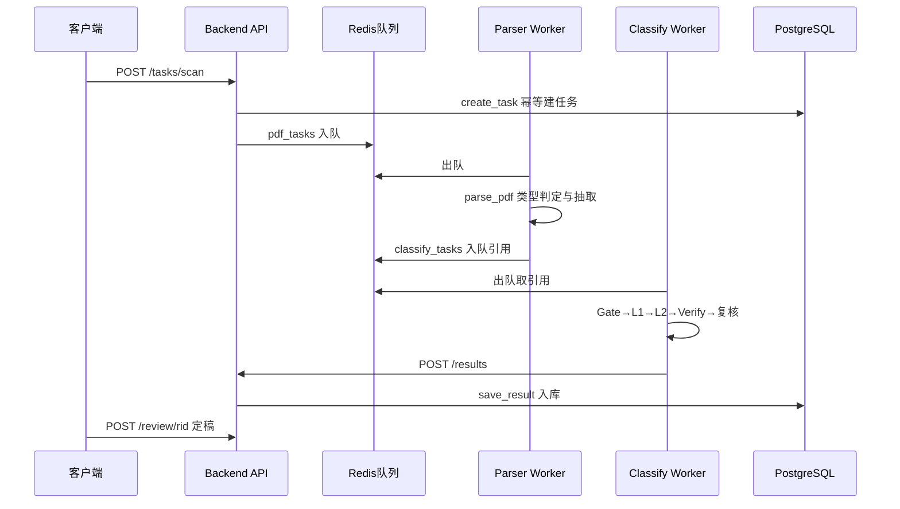

# 900万PDF智能分类系统 · 系统代码架构设计说明书（V3.0）

版本 V3.0｜日期 2026-10-09｜审阅对象：主管、技术负责人｜事实依据：实际代码

配套图示：`docs/deliverables/fig_arch.png、fig_flow.png、fig_seq.png`（由 Mermaid 源图导出，见附录）。

## 1 项目目标

处理约 900 万份 PDF，实现"扫描建任务—解析提证据—相关性判断—一级/二级分类—LLM 自动复核—持久化—人工复核"全链路。约束：单台 Linux GPU 服务器、高吞吐、可断点续跑、全程可审计。

分类体系固定：4 个一级、25 个二级（7+3+9+6），以 `contracts/taxonomy.yaml` 为准，不做修改。结果终态 5 种：CLASSIFIED、IRRELEVANT、MANUAL_REVIEW、FAILED、UNRESOLVED（`backend/store.py`）。

## 2 整体设计思想

- 分层解耦：接入层（Backend API）只做任务建模与入库；执行层（Parser/Classification Worker）无状态可横向扩展；编排层（Scheduler）只传引用推进阶段；存储层分离（Redis 传引用、PostgreSQL 存状态）。
- 引用流转：Redis 只传 task_id 与 parse_ref（`scheduler/handoff.py`，上限 2000 字节），全文走文件引用，避免大对象压垮队列。
- 保守分类：embedding 先行、LLM 约束裁决、阈值未校准一律降级人工（`classifier/pipeline.py::_auto`），宁可进人工也不错归档。
- 能力分级标注：已实现 / Mock 通过 / 真实 CPU 验证 / 真实 GPU 未验证（见第 8 章）。

## 3 系统总体架构




设计说明：API 扫盘建任务（PENDING）后即入队返回；Parser 出队解析落盘回填引用；Classification 出队取引用分类后调 `POST /results` 入库；Scheduler 按 stage 推进与续跑。

## 4 PDF 处理流程


各环节失败按可/不可重试分流（第 7 章），`UNRESOLVED / MANUAL_REVIEW` 进入人工。

## 5 模块调用时序




## 6 模块设计：为什么这样设计、如何协作

### 6.1 Parser

为什么：900 万 PDF 形态差异大（原生文本/扫描/混合/复杂版面），单一抽取后端无法兼顾成本与质量，故先做轻量类型判定再路由。
协作：只输出 `ParseResult`（类型、证据模式、标题、页面），经引用交接给分类，不直接参与类别判断。
智能点：COMPLEX 强制走 MinerU 服务并设误用门禁，避免昂贵链路被滥用。

### 6.2 Classification（核心）

为什么：单模型直判易误收，必须分层收敛。设计为"证据路由→相关性门控→一级→二级→校验→复核"六段，每段只解决一个问题。

- 相关性门控：BGE 打分加关键词加成，分流 RELEVANT / UNCERTAIN / IRRELEVANT；空证据与向量失败一律进 UNCERTAIN，不直接丢弃。
- 一级分类：向量直判（高分且间隔足够）优先，否则 LLM 在 4 个一级内约束选择，禁止创造新类。
- 二级分类与 Reranker：向量取 Top5，Reranker 重排后直判或 LLM 在 Top3 内选择；TBD 类别保守进复核。
- LLM 自动复核：只允许候选 ID / IRRELEVANT / UNCERTAIN；最多 2 轮，第二轮补标题与后续段落；OCR 低置信直接 UNRESOLVED 并建议重解析；调用失败（30 秒超时、重试 2 次）记 FAILED 可重试；两轮不定为 UNRESOLVED 且保留一级（level1 保留、level2 置空）。

### 6.3 Backend

为什么：作为唯一可信写入点，承担幂等、强校验与审计。`uuid5(路径:哈希)` 保证重复扫盘返回同一任务；`save_result` 强制"CLASSIFIED 必带两级、非 CLASSIFIED 不得带类别"；复核仅允许 `MANUAL_REVIEW` 且记录复核人。

### 6.4 Scheduler

为什么：长任务必须可中断续跑。Pipeline 按 9 个 stage 推进，失败只重跑当前阶段语义；可重试错误限 3 次，超限进死信；`resume_pending / pending_from` 按 stage 续跑；GPU 互斥池避免 OCR、MinerU、推理抢卡。

### 6.5 DevOps

为什么：单机多 GPU 必须隔离重型依赖。Compose 编排 8 服务：API/Parser 走 CPU，OCR 用 GPU0/1，MinerU 用 GPU2，推理用 GPU3；PDF 只读挂载，模型与工作数据持久化；Worker 按角色变量启动。

## 7 单机协作与可靠性

Redis 与 PostgreSQL 分工：Redis 只做引用队列与去重集合，PostgreSQL 存任务 stage/status 与分类结果。幂等（任务 uuid5、队列去重）、重试（可重试集合限 3 次）、断点续跑（按 stage）、异常分级（FAILED 可重试、UNRESOLVED / MANUAL_REVIEW 进人工）。

## 8 代码目录与实现状态

```text
backend/        任务建模与入库（已实现，CPU 可测）
parser/         类型判定与抽取路由（已实现；真实 CPU 验证通过，GPU OCR/MinerU 未验证）
classifier/     六段分类流水线（已实现；向量与规则 Mock 通过，真实 GPU 未验证）
scheduler/      队列编排与续跑（已实现，Mock 通过）
deploy/         单机多 GPU 编排（配置完成，未真实部署验证）
contracts/      分类体系与契约（taxonomy 冻结；api 契约含 1 个未实现接口）
```

风险：GPU 相关链路（PaddleOCR、MinerU、BGE-m3、Reranker、LLM 网关）均未在真实服务器验证，不得宣称已上线；阈值未校准期间自动归档被门禁拦截，需首批标注后签署。

## 附录 Mermaid 源图

源图见第 3–5 章代码块；PNG 由源图导出供 Word 使用。

QA 核查：架构、流程、时序与实际源码一致；未编造接口字段；未修改业务代码与分类规则。
