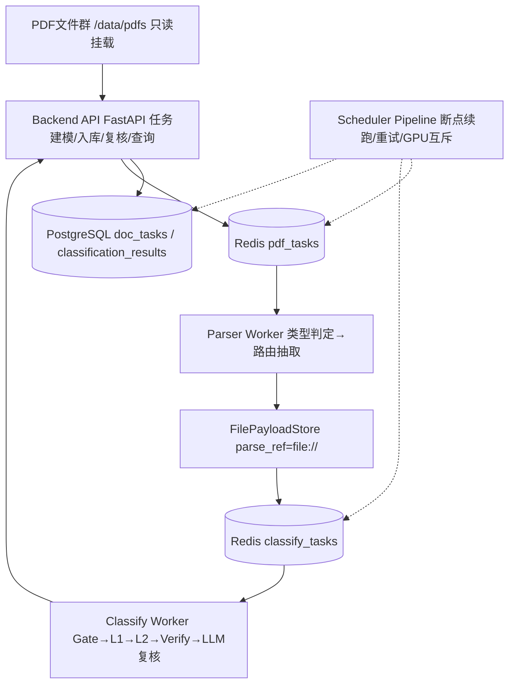
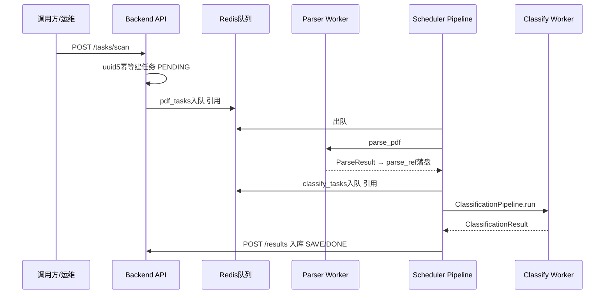

# 900万PDF智能分类系统 · 系统代码架构设计说明书（V3.0）

版本 V3.0 ｜ 2026-10-09 ｜ 供主管审核、开发交接 ｜ 事实口径：实际代码（backend/parser/classifier/scheduler/deploy/contracts）

## 1 项目目标

对约 900 万份 PDF 做"解析提证据 → 相关性门控 → 一级分类 → 二级分类 → LLM 自动复核 → 入库 → 人工复核"全链路处理。约束：单台 Linux GPU 服务器、高吞吐、可断点续跑、全程可审计。分类体系冻结为 4 个一级、25 个二级（7+3+9+6），以 `contracts/taxonomy.yaml` 为准，不在本轮调整。

## 2 整体设计思想

- **引用流转而非全文流转**：Redis 只传任务引用，全文经文件引用（`parse_ref=file://…`）流转，避免队列膨胀。
- **阶段化编排**：Scheduler 按固定阶段推进，失败只影响当前阶段语义，可按 `stage` 断点续跑。
- **证据先行**：先做 PDF 类型判定与证据路由，再做分类，保证长文档与扫描件走不同证据通道。
- **直判优先、LLM 兜底**：embedding/reranker 置信度足够直接定级，否则进入 LLM 约束裁决与自动复核，控制成本与幻觉。
- **终态入库**：所有结果以 5 种终态入库，未达标进人工队列，不丢弃。

## 3 系统总体架构图

Mermaid 源图（矢量图见 `docs/deliverables/arch_*.svg`，Word 版已内嵌同内容表格与流程说明）：



设计解读：接入层只做建模与持久化；Parser 与 Classification 为无状态 Worker，可横向扩展；Scheduler 只做编排不搬运全文；PostgreSQL 存真相，Redis 存流转。

## 4 PDF 处理流程图


## 5 模块调用时序图



## 6 模块设计：为什么这样设计、如何协作

### 6.1 Parser —— 类型决定证据通道

为什么：文本 PDF 与扫描/复杂版面 PDF 的抽取手段完全不同，混用会导致质量与成本双输。先判定类型再路由，保证"文本走解析、图像走 OCR、复杂走 MinerU"。
协作：输出 `ParseResult`，经文件引用交给分类，不直接调分类函数。
细节（仅本节）：类型枚举 TEXT/SCAN/MIXED/COMPLEX/IMAGE；后端映射 pymupdf/paddleocr/mineru 按需；COMPLEX 非 MinerU 服务拒绝；错误分可重试与不可重试两类。

### 6.2 Classification —— 门控、两级、复核三道闸

为什么：900 万规模下相关文档只占部分，先做相关性门控可拦截无关文档；两级分类对应 4→25 的业务层级，直判优先保证吞吐，LLM 只处理疑难。
协作：消费 `parse_ref`，产出 `ClassificationResult` 字典，经 `POST /results` 入库。

- **相关性门控**：embedding 打分加关键词加成，分流 RELEVANT / UNCERTAIN / IRRELEVANT；空证据与 embedding 失败一律进 UNCERTAIN，不误判为无关。
- **一级分类**：embedding 高置信直判，否则 LLM 在四个一级内约束选择。
- **二级分类与 Reranker**：embedding 取 Top5 经 reranker 重排，高置信直判，TBD 类别保守进复核，否则 LLM 在 Top3 内约束选择。
- **LLM 自动复核**：只允许候选 ID / IRRELEVANT / UNCERTAIN，最多 2 轮，第二轮补标题与段落增补信息；OCR 低置信进 UNRESOLVED（REPARSE_OR_VISION）；调用失败进 FAILED；两轮不定进 UNRESOLVED。未校准阈值时任何自动定级强制降级 MANUAL_REVIEW。

### 6.3 Backend —— 真相库与校验门

为什么：Worker 可重跑，入库必须幂等且强校验，否则脏数据不可追溯。
协作：被 Scheduler 的保存函数调用，也直接对外提供查询与复核接口。`save_result` 对 CLASSIFIED 强制要求 L1+L2，非 CLASSIFIED 禁止携带类别；`apply_review` 仅 MANUAL_REVIEW 可写。

### 6.4 Scheduler —— 编排而不搬运

为什么：解析与分类耗时差异大，必须解耦为两条队列；GPU 资源稀缺，必须互斥。
协作：按 SCAN→…→SAVE 阶段推进，失败按可重试集合决策重试（≤3 次）或进死信；按 `stage` 与文件引用续跑；经 GPU 池避免 OCR/MinerU/推理抢卡。

### 6.5 DevOps —— 单机多 GPU 分工

为什么：单台服务器上 CPU 任务与三类 GPU 任务互相干扰，必须按卡隔离。
协作：8 服务编排，GPU0/1 归 OCR、GPU2 归 MinerU、GPU3 归推理（含 embedding/reranker/LLM 网关），CPU 承载 API/Parser/数据库/队列；PDF 只读挂载，模型与工作数据持久化。

## 7 单机运行与数据协作

Redis 承载 `pdf_tasks`、`classify_tasks` 与死信队列，只传引用（上限约 2000 字节）；PostgreSQL 承载任务表与结果表，记录阶段、状态、重试与错误；文件引用层承载全文。Parser 出队解析落盘，分类出队读盘推理入库，Scheduler 全程跟踪阶段。

## 8 实际代码目录树及职责

```text
backend/      对外 API 与持久化（任务建模、结果校验入库、分页查询、人工复核）
parser/       PDF 类型判定与证据抽取路由
classifier/   证据路由、相关性门控、两级分类、校验、LLM 自动复核
scheduler/    队列、阶段编排、重试续跑、GPU 互斥
deploy/       单机多 GPU 容器编排、Worker 启动、监控与运维脚本
contracts/    分类体系与契约（taxonomy、API/数据/状态机契约）
```

## 9 实现状态矩阵（已实现 / Mock / 验证）

| 能力 | 状态 |
|---|---|
| 任务建模、结果入库、分页查询、人工复核、taxonomy 查询 | 已实现（8 路由，真实代码） |
| 队列去重、阶段重试、断点续跑、文件引用流转 | 已实现（FakeQueue 在无 Redis 环境 Mock 通过） |
| Parser 类型判定与路由、分类门控两级复核逻辑 | 真实 CPU 验证通过（pytest） |
| OCR / MinerU / embedding / reranker / LLM 推理 | 真实 GPU 未验证（待首批标注与上机联调） |
| 单机多 GPU 编排 | 仅完成配置与指南，标注未真实部署验证 |
| `POST /results/export` | 仅契约存在，代码未实现 |

## QA 核对

架构图、流程图、时序图与代码调用关系一致；分类体系 4/25（7+3+9+6）与 `taxonomy.yaml` 一致；结果 5 终态与 `store` 一致；未编造字段与接口；未修改业务代码与分类规则。
