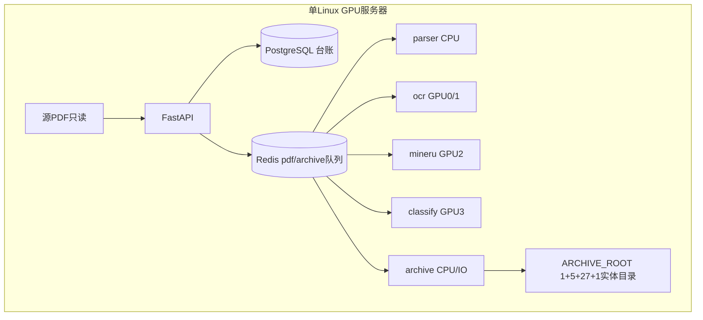

# 01 系统总体架构设计（V3.0，Planner）

复用：`docs/需求整理V3.md` 的业务链路、27 个场景目录和 AR-001～010；冻结契约见 `contracts/phase1/`。`contracts/architecture.md` 只保留单机多 Worker、GPU 分卡和容量预算口径。该文件里直达 `IRRELEVANT`/`MANUAL_REVIEW`、且没有专利门和实体归档的旧链路，不再作为阶段一主流程。

审查修订：2026-10-10。修正门控顺序和未校准阈值；补齐模块职责、PostgreSQL 与 Redis 的分工，以及已有代码和目标闭环的边界。未改代码、迁移和部署文件。

模块划分、接口和流程图的完整写法见 `docs/阶段一_系统总体架构模块与接口详细设计_V3.md`。本文保留单机部署和已有能力边界的短说明。库表逐列以 `docs/design/04_数据库详细设计.md` 为准，字段级「已有 / 计划」以 `docs/design/05_接口详细设计.md` 为准，身份与状态以 `contracts/phase1/` 为准。

## 1 分层与处理顺序

单机进程内分层：FastAPI 收单和查改；Parser 做类型检测与按需证据；Classifier 做漏斗判决；Scheduler 排队、断点和恢复；Archive Worker 复制并校验；PostgreSQL 记账存证；Redis 只传任务引用。

主流程与需求第 2 节同一顺序：

Registry 登记 `file_id` → Dedup 可先算精确 SHA-256，但不得把可能的专利副本提前归入低价值 → Parser 做有效性检查和按需文本证据 → Features（query 不超过 3000 字）→ PatentGate → 低价值中不依赖相关性的四类（LV01、LV02、LV03、LV05；证据不足不得硬判）→ RelevanceGate → 只有确认属于业务范围才进入 Classifier（4 个一级、27 个二级）→ 低置信或冲突进入 Review → 已形成归档决定后交给 Archive。Scheduler 负责任务租约、重试和恢复。Backend 只读写台账，不判类，不拼路径。

顺序铁律：已确认专利 > 已确认低价值五类 > 已确认的 4/27 > 证据不足则 `PENDING`。三级线索只作证据。阈值和词表未批准时进入待复核。

RelevanceGate 的生产阈值尚未校准。禁止把 0.7、0.3 或任何未经验证的分数写成自动通过线。原始相似度不是分类正确概率。未校准结果不得标成 `APPROVED`。

确认无业务匹配只产生 LV04，归档类型为 `LOW_VALUE`，原因码 `LV04`，目录 `02_低价值文件/无业务匹配/`。新写入不得再把 `IRRELEVANT` 当成业务终态；旧数据只按 LV04 读兼容。

## 2 单机部署

- 一台 Linux GPU 服务器上的多进程或多容器，不是多机集群。
- Registry、Dedup、文本直提和 Archive 跑在 CPU 上，可以横向增加 Worker。
- 本机 GPU 分工：0/1 做 OCR，2 做 MinerU，3 做 BGE、Reranker 和 LLM。这是当前服务器约束。换卡或实测比例变化后再改编号。
- 源目录只读。`ARCHIVE_ROOT` 必须在扫描源之外。工作区、源目录、归档根三者隔离，避免扫到归档副本。
- `contracts/architecture.md` 里的页速度和机器规格是预算假设，不是验收承诺。没有真实样本 Benchmark 之前，不得宣称 900 万份能在 2026-12-31 前处理完。

## 3 模块职责

| 模块 | 职责 | 明确不做 |
|---|---|---|
| Registry | 扫描只读源，按规范路径登记；新 `file_id` 为 UUIDv7，只在首次插入成功时留下 | 不分类，不复制归档；不用 `seen`、路径哈希或 uuid5 做登记幂等 |
| Dedup | 精确 SHA-256 和重复组成员；近重复只出证据 | 不删除源；不把专利副本提前送入 LV02 |
| Parser | 有效性、文本层直提；图像页或混合页按需 OCR；复杂版式按需 MinerU | 不判决类别 |
| Features | 清洗后的有限 query 和页码证据 | 不落归档路径 |
| PatentGate | 用文件名、元数据、首页、专利号等多证据确认专利 | 不得因缺文本判成非专利 |
| LowValueGate | 判断 LV01、LV02、LV03、LV05 | 词表和阈值未批准时不自动排除；LV04 不在本门硬判 |
| RelevanceGate | 输出相关、确认无匹配或不确定 | 低分不等于无匹配；确认无匹配才映射为 LV04 |
| Classifier | 只对相关文件做 4/27，并校验父子关系；疑难件有限次 LLM | 不拼目录；综合管理不是兜底类 |
| Review | 人工确认或改判，决策版本加 1，保留机器原判断 | 不覆盖历史记录 |
| Archive | 按 taxonomy-v3 映射复制、校验、回写 | 不移动、不删除源；不接受调用方自造路径 |
| Scheduler | Redis 队列、优先级、租约、断点和重投 | `seen` 不是登记幂等，不得用它判断路径是否已登记。它只挡住同一队列消息重复入队，不永久拒绝失败后的合法重试。登记幂等在 PostgreSQL |
| Backend | HTTP、事务、台账查询和复核写入 | 不做算法，不执行文件复制 |

## 4 数据流、存储与归档恢复

PostgreSQL 是权威状态，保存文件、任务、源字节版本、决策版本、复核、归档执行和审计。新 `file_id` 与新 `task_id` 都是 RFC 9562 UUIDv7（36 位小写、带连字符，列类型 TEXT），新行二者不得相等。已经复制的历史行保持 32 位小写十六进制，允许二者相等，不得改写成 UUIDv7。`batch_id` 是批次表的整数代理键，不得当作 `file_id`。登记幂等在 PostgreSQL，靠规范路径唯一约束 `uq_file_registry_source_path`。同一路径内容变化时 `file_id` 不变，只追加 `content_version`。不同路径即使字节哈希相同也分别登记。`source_sha256` 只保存文件字节哈希，可空且非唯一；路径字符串哈希不得写入该列。

Redis 仍只传小消息。`pdf_tasks` 的信封键是 `task_id`，载荷带 `file_id`、`task_id` 与 `content_version`（哈希未确认时为 JSON `null`）。`archive_tasks` 携带 `file_id`、决策 `version`，以及该决策所依据的 `content_version`。决策 `version` 是判决版本，与 `content_version` 不是同一个数。Worker 见到严格更旧的 `content_version` 就丢弃，不写决策、不复制。消息与当前版本都为空时不是更旧，仍可处理。PDF 正文和解析全文不进 Redis。队列丢失时，按 PostgreSQL 里未完成的状态重新入队，不插入第二个 `file_id`。`seen` 只描述当前队列实现里的投递记录，不是文件登记幂等。

成本顺序：有可用文本层就直接提取；只对图像页或混合页补必要 OCR；LLM 只用于疑难件，并且有次数上限，到达上限后进入待复核。阶段一不做全量 Markdown、全量全文 OCR 和全量 LLM。

归档闭环以 `contracts/phase1/archive-contract.md` 为准，要点如下：

1. 已批准决策写入正式目录。决策为 `NEED_REVIEW` 时，实体进入 `04_待复核暂存/`，使用独立暂存状态，不计入业务正式归档。
2. 目标相对目录只查 `contracts/phase1/taxonomy-v3.yaml`：`PATENT` → `01_专利文件/`；`LOW_VALUE` → `02_低价值文件/{五类目录名}/`；`BUSINESS` → `03_业务分类/{一级目录}/{二级目录}/`；`PENDING` → `04_待复核暂存/`。非法一级、二级组合拒绝写入。
3. 在目标文件系统写临时文件，流式复制，字节数和 SHA-256 都通过，且源指纹未变，再做原子替换。
4. 然后在 PostgreSQL 事务中写入 `archive_status=COMPLETED` 和目标路径。校验失败不得写 `COMPLETED`。源文件当前 `content_version` 大于该决策所依据的 `content_version` 时，也不得写 `COMPLETED`，不得用这份旧决策覆盖新内容。
5. 幂等：最终文件已在且校验通过，则补记 `COMPLETED`，不生成第二份副本；只剩下临时文件则删除后重来；库未提交则重新入队。
6. 复核改类时决策版本加 1。新副本校验成功后，旧执行标 `SUPERSEDED`。同一文件只保留一个有效主归档，不删除源 PDF。源字节 `content_version` 从 N 升到 N+1 时，不把已有 `COMPLETED` 改成 `SUPERSEDED`，不删除旧归档。旧决策保留，等新内容走完门控后再产生新的决策版本。
7. 可重试的 I/O 做有界重试。校验失败时删除临时文件后再重试。磁盘满则停批并告警。唯一文件名算法、是否允许硬链接仍为 TBD，现有代码里的命名函数不是已批准规则。

## 5 已有能力与计划能力

已有、可复用：

- Backend 已实现 8 个 HTTP 路由：`POST /tasks/scan`、`GET /tasks/{task_id}`、`GET /results`、`GET /results/{id}`、`POST /results`、`GET /review/queue`、`POST /review/{id}`、`GET /taxonomy`。复核队列当前只认 `MANUAL_REVIEW`。
- Parser 已有三路分流和证据。Classifier 已有旧漏斗、二审和 `UNRESOLVED`。分类路径仍带旧 25 类口径，生产阈值未校准。
- Scheduler 已有队列和重试骨架。

仓库里已有文件，但不是闭环，不能算完成：

- `classifier/taxonomy_v3.py` 提供 4/27 目录映射。
- `backend/registry.py` 只做带上限的源扫描和 `file_id`，不写 PostgreSQL。当前这个 `file_id` 仍由 uuid5 从路径算出，属于已有旧行为。计划登记改为 UUIDv7，幂等靠规范路径唯一约束。
- `scheduler/archive_worker.py` 只做本地整文件读入、复制和哈希。没有队列租约，没有版本废弃，没有 `COMPLETED` 回写。

计划中，当前不能当成已交付：

- PatentGate 和 LowValueGate 前置，以及 LV04 与旧 `IRRELEVANT` 写路径分离。
- 复核同时接受进入复核的 `MANUAL_REVIEW` 与 `UNRESOLVED`，并触发重归档。二者在业务上仍同归待复核暂存。
- `GET /archive/{file_id}`。这是 `contracts/phase1/api-contract.yaml` 中的第 9 个 HTTP 接口，`backend/app.py` 里还没有。
- `backend/migrations/002_archive.sql` 仍是草案，未在真实 PostgreSQL 执行，不能报迁移完成。
- 真 GPU、阈值校准，以及 900 万规模 Benchmark。

正式 HTTP 路径以 `docs/阶段一_系统总体架构模块与接口详细设计_V3.md` 第 6 节、`docs/design/05_接口详细设计.md` 和 `contracts/phase1/api-contract.yaml` 的 9 个路径为准。扫描响应的计划字段以 05 为准。
