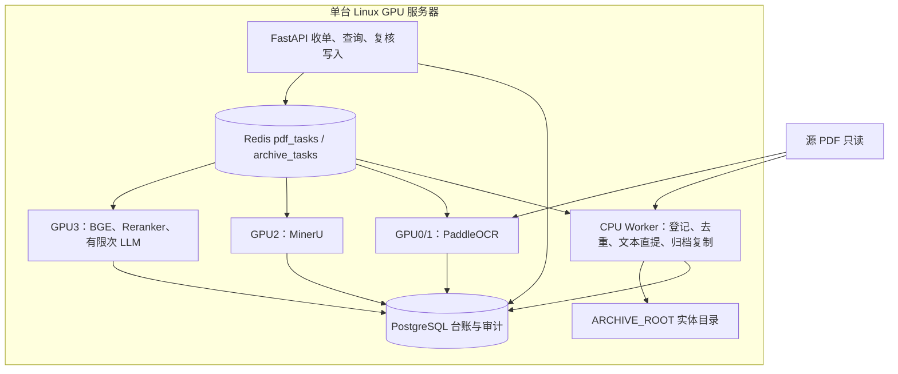
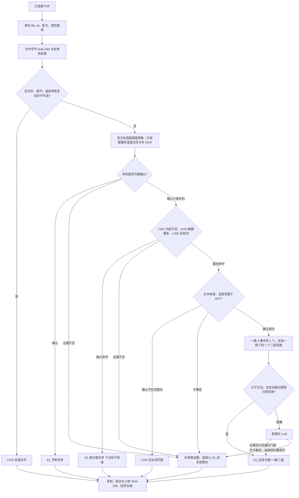
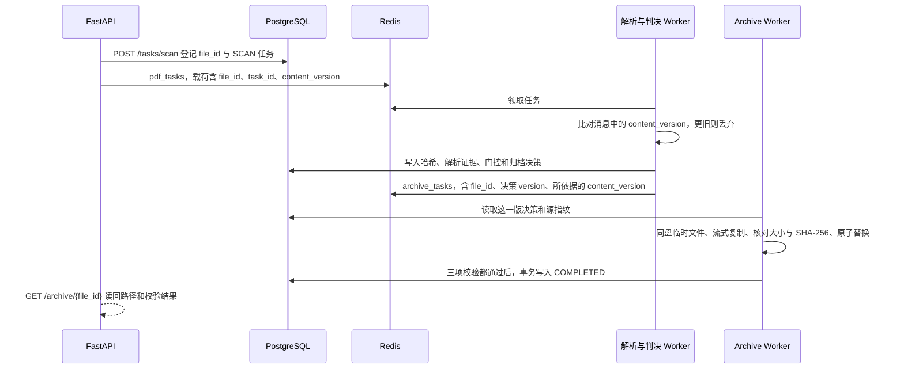
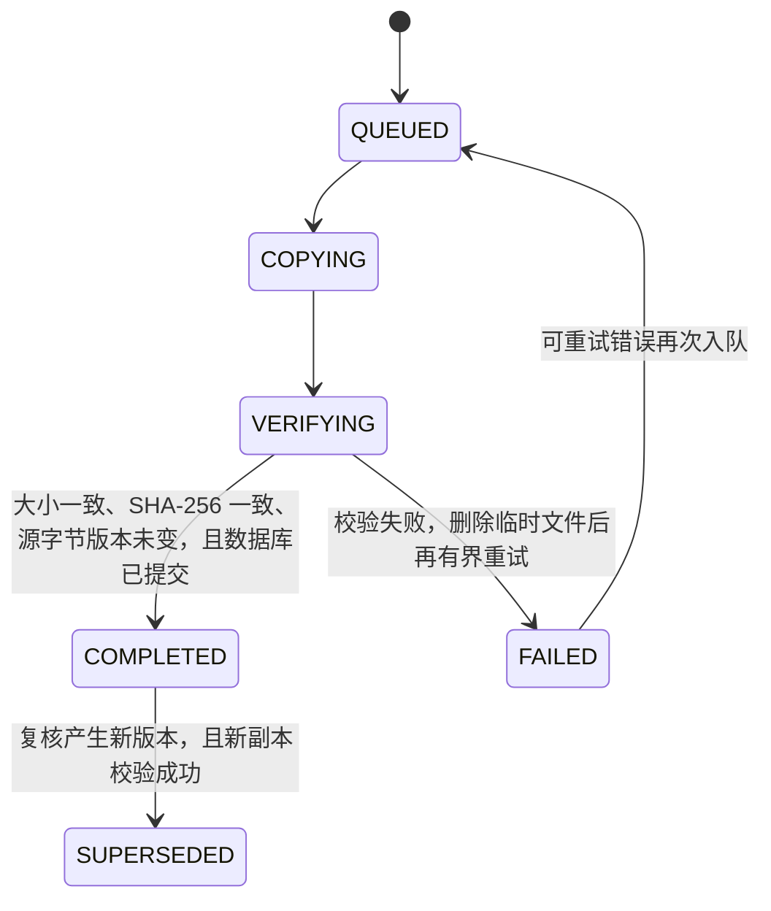

# 阶段一：代码架构、模块与接口设计

**版本**：V3.0  
**日期**：2026-10-10  
**读者**：Backend、Parser、Classification、Scheduler、QA  
**业务依据**：`docs/需求整理V3.md`  
**分类目录**：`contracts/phase1/taxonomy-v3.yaml`（`v3.0-phase1`）  
**状态名**：`contracts/phase1/state-machine.md`  
**身份与队列表**：`contracts/phase1/data-contract.md`、`docs/design/04_数据库详细设计.md`  
**字段级「已有 / 计划」对照**：`docs/design/05_接口详细设计.md`

本文写阶段一要做成的模块划分、模块之间怎么交接、对外 HTTP 和队列长什么样，以及三张必须遵守的流程图。库表逐列以 04 为准。当前代码已经做到哪一步、响应字段还差什么，以 05 为准。本文描述目标设计。把「计划」写成「已经上线」会和 05 冲突。

正式 HTTP 只有 `contracts/phase1/api-contract.yaml` 里的 9 个路径。不使用 `/api/v1/batches` 这一套草案。根目录 `contracts/architecture.md` 里直达无关或人工、且没有专利门和实体复制的旧链路，不作为阶段一主流程。

## 1. 系统要交付什么

输入是服务器上约 900 万份 PDF，只读，可以有多个源根目录和批次。

输出有两样，缺一不可：

1. **实体目录**。`ARCHIVE_ROOT` 在扫描源之外，下面实际建出专利目录、低价值 5 个子目录、4 个一级共 27 个二级场景目录、待复核暂存目录。每个已形成结论的文件，都有一份复制过去的 PDF。
2. **台账**。每份文件保留源路径、`file_id`、判断证据、规则和模型版本、决策版本、目标路径、大小和 SHA-256 校验、人工修改历史。

完成标准：目标路径上的 PDF 真实存在，字节数一致，SHA-256 一致，并且 PostgreSQL 已提交 `archive_status=COMPLETED`。只有数据库标签不算归档完成。源 PDF 不删除、不覆盖。

阶段一做登记、精确去重关系、必要文本提取、按需 OCR、专利与低价值排除、4/27 分类、疑难有限次 LLM、实体复制和人工复核回流。阶段一不做全量 Markdown、全量全文 OCR、全量 LLM。

四个归档归宿：

| 枚举 | 何时写入 | 实体目录 |
|---|---|---|
| `PATENT` | 专利已可靠确认 | `01_专利文件/` |
| `LOW_VALUE` | 非专利，且已确认 LV01–LV05 之一 | `02_低价值文件/{原因目录}/` |
| `BUSINESS` | 已确认属于业务范围，且一级、二级是合法的一对 | `03_业务分类/{一级}/{二级}/` |
| `PENDING` | 证据不足、规则冲突或未校准 | `04_待复核暂存/` |

业务口头说的 `PENDING_REVIEW` 和枚举 `PENDING` 是同一个暂存区。决策状态写 `NEED_REVIEW`。本阶段不另设拒识目录。综合管理及其任一二级场景不能当作「没法归类」的兜底。

主目录优先级：已确认专利 > 已确认任一低价值 > 已确认的 4/27 > 证据不足则待复核。精确哈希可以提前算，但不能把可能的专利副本提前送进「重复件」。

## 2. 总体架构

一台 Linux GPU 服务器上的多进程。PostgreSQL 保存权威状态。Redis 只传任务引用，不传 PDF 正文。



三块存储互相隔离：

- 源目录：只读。扫描根落在 `ARCHIVE_ROOT` 之内时，扫描接口返回 400，避免把归档副本再扫进来。
- 工作区：解析证据、临时文本。有生命周期，不充当归档结果。
- `ARCHIVE_ROOT`：唯一主归档。复制、校验、原子替换都在这块存储上完成。

GPU 编号是当前这台机器的分工。换卡或实测比例变化后再改编号。页速度和机器规格如果出现在旧架构说明里，只是预算假设，不是 2026-12-31 的吞吐承诺。没有真实样本 Benchmark 之前，不宣称 900 万份能按期处理完。

代码按下面的进程边界放，HTTP 不直接调用专利判断，也不直接复制文件。

| 层 | 代码位置 | 做什么 |
|---|---|---|
| Backend | `backend/` | FastAPI、事务、台账查询、复核写入 |
| Registry | 目标 `registry/`；现有扫描在 `backend/registry.py`，尚未接入扫描接口 | 只读扫描、分配 `file_id`、记批次游标 |
| Dedup | 目标 `dedup/` | 文件字节 SHA-256、重复组成员 |
| Parser | `parser/` | 有效性、文本层、按需 OCR、按需 MinerU |
| Features | `classifier/evidence.py` | 清洗后的有限 query 和页码证据 |
| PatentGate / LowValueGate | 目标 `exclusion/` | 专利，以及 LV01、LV02、LV03、LV05 |
| RelevanceGate / Classifier | `classifier/gate.py`、`classifier/pipeline.py` | 相关性，然后才做 4/27 |
| Review | `backend/` 复核写入 | 机器没下成结论的文件，由人给出结论 |
| Archive | 目标 `archive/`；现有复制在 `scheduler/archive_worker.py` | 查表得目录、复制、校验、回写 |
| Scheduler | `scheduler/` | 队列、租约、断点、重投 |

## 3. 流程图

### 3.1 业务判定

这张图是归档决策顺序。廉价步骤可以提前做，结论仍按这张图落目录。



读图时固定这几条：

1. 结构上已经确认的空文件或损坏，可以在解析早期记为 LV03。这个结论靠文件有效性，不靠「正文里看不出专利」。
2. 只有文本层缺失、OCR 失败或解析超时，不能记成 LV03，也不能记成 LV01，更不能据此排除专利。临时 I/O 错误重试，不进复核结论。
3. LV04 只有一条来路：文本证据有效，相关性门控可靠确认不在 4/27 范围内。低分、候选接近、模型互相矛盾，都进待复核。
4. 专利副本即使字节与另一份相同，主目录仍是专利目录。重复关系单独保存，不删除副本。
5. 多个低价值原因可以同时记下。主原因目录在业务批准前不自动挑选，整份文件进待复核。
6. 阈值、否定词表、内容不足数值、专利文献范围未批准时，走补证据或待复核。不写死自动排除。

### 3.2 一份文件从登记到验收



分类结果写入数据库，只说明逻辑决策已经留下。`COMPLETED` 还要等复制和校验。待复核文件也可以复制到 `04_待复核暂存/`，这条完成记录不计入业务正式归档。

### 3.3 归档执行状态

任务状态、决策状态、复核状态、归档状态是四条轴，互不混用。



| 轴 | 状态 | 含义 |
|---|---|---|
| 任务 | `PENDING → RUNNING → DONE / REVIEW / FAILED` | 某一阶段的执行。可重试的 I/O 失败留在失败可重入，不写成复核结论 |
| 决策 | `APPROVED` 或 `NEED_REVIEW` | `APPROVED` 覆盖专利、低价值、业务三类已确认结论。`NEED_REVIEW` 不是业务类别 |
| 复核 | `OPEN → RESOLVED` | 关闭时决策版本加 1，并重新投递归档 |
| 归档 | 上图 | `COMPLETED` 必须同时有真实文件、两项校验和已提交的库记录 |

## 4. 模块设计

十二个模块按一份 PDF 的处理顺序排列。前四个准备材料和身份，中间四个做判断，最后四个负责人、落盘、排队和对外查询。目录路径只允许 Archive 查分类表生成。

| 模块 | 为什么单独存在 | 具体干什么 |
|---|---|---|
| Registry | 900 万份文件要先有稳定身份。没有 `file_id`，去重、复核和归档对不上同一份 PDF | 扫描只读目录，给每个路径发一个 `file_id`，记下大小、修改时间和批次 |
| Dedup | 完全相同的文件要记成一组。专利的重复副本仍要进专利目录，不能一发现重复就当废件 | 计算文件字节的 SHA-256，编重复组，标出主件 |
| Parser | 后面的判断需要正文，全量 OCR 又太贵 | 能读文字层就直接提取；只有图像页或混合页才补必要的 OCR |
| Features | 专利、低价值和分类必须看同一份短证据，并要能指回某一页 | 整理标题、正文片段和页码，压成不超过 3000 字的查询文本 |
| PatentGate | 需求规定先确认专利。确认后就不再做低价值和 27 个场景 | 用文件名、首页、专利号等判断这份是不是专利文献 |
| LowValueGate | 确认不是专利之后，内容不足、重复、损坏、否定词要先拿掉，避免挤进业务目录 | 判断 LV01、LV02、LV03、LV05 |
| RelevanceGate | 剩下的文件里，有的根本不属于这 4 个一级。分数低不能直接当成无关 | 判断它在不在 4/27 的业务范围里 |
| Classifier | 只有确认属于业务范围的文件，才需要分到 27 个场景里的一个 | 选出一对一级和二级 |
| Review | 证据不足时不能硬分进正式目录，要有人看原件再下结论 | 列出待办，保存人的结论，并触发按新目录重新复制 |
| Archive | 台账里写了类别，文件夹里还不一定有文件 | 按分类表把 PDF 复制到目标目录，核对大小和 SHA-256，再回写完成 |
| Scheduler | 900 万份要分批跑。中断、失败之后要能从上次停下的地方继续 | 排队、占用、超时重试、按数据库里的未完成任务重新入队 |
| Backend | 运维、复核人和分类 Worker 在别的进程里，不能各自改库、各自拷文件 | 提供第 6 节的 9 个 HTTP，做密钥校验和数据库事务 |

### 4.1 Registry

一份 PDF 从进入系统到最后归档，都要用同一个身份指它。Registry 负责发这个身份。它只扫描源目录，不判断类别，也不复制文件。

它为每个规范路径建立稳定 `file_id`。新 `file_id` 是 RFC 9562 UUIDv7，36 位小写、带连字符，只在该路径第一次插入成功时留下。同一路径再次扫描读回原来的 `file_id`。内容字节变化时 `file_id` 不变，只追加 `content_version`。不同路径即使字节哈希相同，也各有自己的 `file_id`。

代码放在目标目录 `registry/`。现有扫描在 `backend/registry.py`，还没有接到 `POST /tasks/scan`。

`batch_id` 是批次表的整数主键，只记这份文件第一次登记时的批次。它不是 `file_id`。同一批次续扫使用 `cursor_path`，只处理字典序严格大于游标的路径。要发现游标之前的新文件，或已登记文件的内容变化，另起一个新批次做重扫，仍然不产生第二个 `file_id`。

登记幂等靠 PostgreSQL 的规范路径唯一约束。登记事务不读、不写 Redis 的 `seen`。

失败：根目录不存在，整批失败且可重试。单个文件 `stat` 失败则跳过并记错误，不中断整批。`lstat` 失败时不推进游标。

### 4.2 Dedup

同一份 PDF 经常以不同路径存了多份。Dedup 先把字节完全相同的文件归成一组，记下谁是主件、谁是成员。它只建立这层关系，不决定文件最后进哪个目录，也不删除源文件。

输入必须是文件原始字节的 SHA-256，64 位小写十六进制，外加字节数。输出重复组：`group_id`、是否精确重复、主件 `file_id`。精确相同可以确认重复关系。近重复只输出证据，算法和阈值未批准，不自动认定。

代码放在目标目录 `dedup/`。

本模块不返回归档路径。主件如果已经确认是专利，副本可以继承这份专利证据；版本或证据继承不了，副本进待复核，不进「重复件」目录。

### 4.3 Parser

判断模块需要看到 PDF 里的字。Parser 负责把字拿出来，并说明拿出来的方式。有文字层就用 PyMuPDF 直接提取。扫描页或图文混排的页，才把必要页交给 PaddleOCR。版面很复杂时才调用 MinerU。它不决定这是专利、低价值还是某个业务场景。

打开只读 PDF，判断有没有可用文本层。每条证据保留页码。

代码放在 `parser/`。OCR 跑在 GPU 0/1，MinerU 跑在 GPU 2。

OCR 和 MinerU 有次数上限。到达上限后把「证据不足」交给后面的门控，由门控进待复核。解析函数自己不判断内容够不够，也不写类别。

加密或 0 页：返回失败且不可按 I/O 重试，交给有效性规则决定是不是 LV03。文件暂时打不开且错误可重试：由 Scheduler 重投，不记成无效文件。

### 4.4 Features

Parser 拿出来的可能是很多页原文。Features 把它收成后面几个门控共用的一份短证据：标题、正文片段、出现在第几页。分类查询文本不超过 3000 字。清洗后的句子要能对回原文位置。三级业务线索只留在证据里，不做成文件夹。解析失败时不编造正文。

它不写数据库，也不拼归档路径。代码放在 `classifier/evidence.py`。

### 4.5 PatentGate

这是第一道判断。需求要求专利文件直接进 `01_专利文件/`，即使它也像某个业务场景，或者和另一份文件字节相同。PatentGate 用文件名、元数据、首页、专利号、公开号和文献结构一起判断。确认是专利后，低价值判断和 27 个场景都不再做。

证据不够时，先在有限次数内补正文或 OCR。仍然不够，就进待复核。只有文字层缺失时，它不能给出「不是专利」这个结论。

代码放在目标目录 `exclusion/`。专利文献是否包括申请、授权说明书、证书和行政文件，业务尚未批准。未覆盖的类型进待复核。写入排除记录时记下所依据的 `content_version`。

### 4.6 LowValueGate

这是第二道判断，只处理 PatentGate 已经确认不是专利的文件。它把明显不值得进入 27 个场景的文件分到低价值子目录，从而少做后面的分类。它只判断下面四类：

| 原因 | 目录 | 可以自动确认的条件 |
|---|---|---|
| LV01 | `内容不足/` | 必要抽取和补救之后，确实没有可用业务内容。数值阈值未批准 |
| LV02 | `重复件/` | 字节级 SHA-256 相同，且主目录优先级允许它离开专利 |
| LV03 | `无效文件/` | 有效性检查与有界恢复后，确认为空文件、损坏或不可处理 |
| LV05 | `命中否定词/` | 命中已批准的排除词，并且满足上下文、作用范围和例外。正式词表未批准 |

未批准的阈值和词表不自动排除。OCR 失败不在这里改写成 LV01 或 LV03。LV04 不在这道门产生。代码放在目标目录 `exclusion/`。

### 4.7 RelevanceGate

这是第三道判断。文件已经确认不是专利，也没有命中内容不足、重复、损坏或否定词。RelevanceGate 回答一个问题：它属不属于这 4 个一级、27 个场景的业务范围。确认不属于，才放进 `02_低价值文件/无业务匹配/`，原因记为 LV04。还不确定，就进待复核，此时还不挑选 27 个场景中的一个。

它只处理低价值四类都未确认的文件。输出三态：相关、确认无匹配、不确定。

代码放在 `classifier/gate.py`。生产阈值尚未用标注集校准。原始相似度不是分类正确概率。未校准的结果保持待复核，不标成 `APPROVED`。

### 4.8 Classifier

这是第四道判断，也是唯一给业务文件选场景的模块。前面已经确认这份 PDF 属于业务范围。Classifier 在 4 个一级里选 1 个，再只在这个一级下面的场景里选 1 个二级，例如「安全生产 / 消防监管」。它不负责把文件拷进文件夹。

只对「确认相关」的文件做这一步。一级先召回，二级只在该一级内部排序。一级和二级必须能在 `taxonomy-v3.yaml` 里配成父子，否则拒绝写入业务目录，记录校验错误并进入复核或重试。

代码放在 `classifier/pipeline.py`。BGE、Reranker 和有限次 LLM 跑在 GPU 3。

疑难件可以调用有限次 LLM。次数用尽仍不确定，决策为 `NEED_REVIEW`，实体进待复核暂存。综合管理不是兜底类。本模块不拼目录路径。

二级稳定 ID 尚未全部冻结。落盘用 Excel 原名。数据库在 ID 批准前不以目录显示名充当主键；未批准的编码保持待定，不写成已冻结主键。

### 4.9 Review

机器已经判准的文件直接进专利、低价值或 27 个业务目录，不出现在复核人的待办里。Review 只接收机器停下来的文件：像专利但证据不够、两个场景分数接近、OCR 看不清、规则互相矛盾。这些文件的分类还没有完成，所以先放在 `04_待复核暂存/`。复核人看原件后给出结论，分类才算完成，Archive 再按这个结论复制到正式目录。

如果后来发现一份已经自动归档的文件分错了，复核人也可以提交另一条结论。系统保留原来的机器判断，按新结论再复制一次。这是改正，不是每份文件的必经步骤。

机器判不准的 PDF 先复制到 `04_待复核暂存/`，同时在台账里留下一条未关闭的复核单。复核人是看这些文件的业务人员，不是另一个自动模块。

代码放在 `backend/` 的复核写入里。对外是 `GET /review/queue` 和 `POST /review/{id}`。

他做两步：

1. 打开待办列表，拿到一份还没人下结论的文件，看源 PDF、页码证据和机器给出的候选。
2. 看完后提交人的结论：这是专利、这是某一类低价值、这是某一对一级和二级场景，或者退回去继续处理。

例如一份文件像危险化学品材料，又像综合办公里的公文，两边分数接近。机器把它放进待复核，不放进 27 个业务目录。复核人打开原件，确认主责是「安全生产 / 危险化学品监管」，提交这条结论。系统保留机器原来的判断，另记一版人的结论，再把 PDF 从暂存目录复制到 `03_业务分类/安全生产/危险化学品监管/`。

复核队列同时接纳进入复核的两类旧结果：`MANUAL_REVIEW` 和 `UNRESOLVED`。它们在业务上进同一个暂存目录。

复核人可以确认专利、确认 LV01–LV05、指定一对合法的一级和二级，或退回继续处理。退回不生成新的正式目录。提交和机器原判断分表保存。新决策版本是旧版本加 1。同一事务写下一条归档决策，事务提交后再投 `archive_tasks`。文件复制不在这个事务里。

并发提交带期望版本。版本不符返回冲突，调用方重新读取后再提交。

### 4.10 Archive

判断结束后，磁盘上还没有目标文件。Archive 按已经生效的结论，把源 PDF 复制到对应文件夹，核对大小和 SHA-256，再把「文件确实在这里」写回台账。验收看的就是这一步的结果。

它读取当前有效的归档决策。目标相对目录只查分类表：

代码放在目标目录 `archive/`。现有复制在 `scheduler/archive_worker.py`，还没有按决策版本回写 `COMPLETED`。

- `PATENT` → `01_专利文件/`
- `LOW_VALUE` → `02_低价值文件/{内容不足|重复件|无效文件|无业务匹配|命中否定词}/`
- `BUSINESS` → `03_业务分类/{一级目录名}/{二级目录名}/`
- `PENDING` → `04_待复核暂存/`

调用方、模型或请求体里的自由路径一律拒绝。目标必须落在 `ARCHIVE_ROOT` 内。源路径必须在归档根之外。

复制步骤：

1. 在目标文件系统写临时文件，流式复制，边复制边算哈希。
2. 比对字节数、目标 SHA-256，并确认源文件当前 `content_version` 仍等于这条决策所依据的版本。
3. 通过后在同一文件系统内原子替换。
4. 再在一个数据库事务里写入 `COMPLETED`、最终路径和完成时间。
5. 任一步失败，不写 `COMPLETED`。校验失败先删临时文件，再有界重试。磁盘满则停止领取新的归档任务并告警。

幂等：最终文件已经在，而且校验通过，只补记 `COMPLETED`，不复制第二份。只剩下临时文件就删掉重来。数据库事务没提交就重新入队。

复核改类：新副本校验成功后，旧执行标 `SUPERSEDED`，与新的 `COMPLETED` 同一事务提交，保证一个 `file_id` 只有一条 `COMPLETED`。源 PDF 不删除。旧副本默认保留并标废弃，物理删除未批准。

源字节从版本 N 升到 N+1 时，不把已经 `COMPLETED` 的旧归档改成 `SUPERSEDED`，也不删旧文件。旧决策保留。新内容重新走门控，再产生新的决策版本。

唯一文件名算法、是否允许硬链接，仍未批准。现有代码里的命名函数不是生产规则。

### 4.11 Scheduler

900 万份不能在一个进程里一次做完。Scheduler 把登记、解析、判断、复制拆成队列里的任务，分给 CPU 和 GPU Worker。某份文件失败或机器重启后，它按数据库里还没做完的记录重新入队，而不是再发一个新的 `file_id`。

它消费 `pdf_tasks` 和 `archive_tasks`。负责任务租约、确认、退避重试和阶段断点。

代码放在 `scheduler/`。

Worker 开始前比较消息里的 `content_version` 和文件当前 `content_version`。两边都空，不算更旧。消息严格更旧：丢弃，不写决策，不复制。提交阶段结果时，更新条件带上开始时看到的版本；更新行数为 0 就丢弃这次结果。

`seen` 只描述某次投递是否已经进过队列。它不能用来判断路径有没有登记，也不能永久挡住失败后的合法重试。队列丢失时按数据库里仍为 `PENDING` 的任务重新投递，不插入第二个 `file_id`。

### 4.12 Backend

运维要启动扫描、查看进度，复核人要打开待办并提交结论，分类 Worker 要把算完的结果交回来。这些调用都从 Backend 进入系统。它校验密钥，用事务写台账。模型计算和文件复制仍由对应 Worker 完成。

它提供第 6 节的 9 个 HTTP 接口。归档任务只在归档决策提交成功之后投入队列。

代码放在 `backend/`。

## 5. 模块之间交接的数据

上一节说每个模块干什么。这一节规定前一个模块交给后一个模块的是什么，以及 Scheduler 用哪个函数去调用它。这些函数在本机进程里调用，不是那 9 个 HTTP 接口。

数据对象是一张交接单。例如 Registry 交出 `FileRecord`，里面有 `file_id` 和源路径；Parser 交出 `ParseResult`，里面有抽出的正文在哪一页。后一个模块只认这张单子上的字段，不自己再去猜上一环节的内部结构。

函数签名是调用写法：函数名、要传入什么、会返回哪张交接单。`Parser.parse(文件路径) -> ParseResult` 的意思是，Scheduler 把路径交给 Parser，Parser 必须交回一份解析结果。

大文本和 PDF 用 `payload_ref` 交接，也就是一个存放位置。Redis 消息里不放正文。

| 对象 | 关键字段 | 约束 |
|---|---|---|
| FileRecord | `file_id`、`source_path`、`source_sha256`、`bytes`、`mtime`、`batch_id`、`content_version`、`id_origin` | 路径在允许的源根内。`source_sha256` 只存文件字节哈希，可空、非唯一 |
| ProcessingTask | `task_id`、`file_id`、`stage`、`content_version`、`task_origin` | 同一文件同一阶段一行。失败重试和内容升版不换 `task_id`。新的 `task_id` 与 `file_id` 不得相等 |
| DedupResult | `group_id`、`is_exact_dup`、`master_id` | 精确重复只建成员关系 |
| ParseResult | 类型、页数、页证据、OCR 页、提取器、质量、错误、`payload_ref` | OCR 失败单独记录 |
| FeatureResult | `query_text`、页码证据、文本指纹 | `query_text` 不超过 3000 字 |
| ExclusionDecision | 专利命中与证据，或 LV01–LV05 与证据，决策 `version`，所依据的 `content_version` | 两个版本号不是同一个数 |
| ClassificationResult | 一级、二级、候选分数、`taxonomy_version`、决策 `version`、`content_version` | 二级必须属于该一级。低置信不写成已批准 |
| ArchiveDecision | `file_id`、决策 `version`、`content_version`、`archive_type`、一级、二级、原因、`target_dir` | 同一文件同一决策版本只有一个主目录 |
| ArchiveExecution | 临时路径、最终路径、`bytes_ok`、`sha_ok`、`src_unchanged`、状态 | 三项都真且库已提交，才是 `COMPLETED` |
| ReviewDecision | 原版本、新版本、新的目标类型 | 新版本 = 原版本 + 1 |

`content_version` 随源字节增加。决策 `version` 随判决或复核增加。写排除、分类和归档决策时，两列都要留下。归档执行时如果源文件当前内容版本已经大于决策上记录的内容版本，这条旧决策不能写成 `COMPLETED`。

进程内函数由 Scheduler 调用。签名表达职责，实现可以是函数或类方法，字段含义保持不变。

```text
Registry.scan(root, limit) -> FileRecord 列表
Dedup.exact(file_id, source_sha256, nbytes) -> DedupResult
Parser.parse(file_path, ocr_backend, mineru, max_pages) -> ParseResult
Features.build(parse) -> FeatureResult
PatentGate.check(file_id, feature, dedup) -> ExclusionDecision
LowValueGate.check(file_id, feature, dedup) -> ExclusionDecision
RelevanceGate.check(query, taxonomy_version) -> 相关 / 确认无匹配 / 不确定
Classifier.classify(feature, taxonomy_version) -> ClassificationResult
Review.apply(file_id, submission, expected_version) -> ReviewDecision
Archive.target_dir(archive_type, taxonomy_version, level1, level2, reason) -> 相对目录
Archive.copy(...) -> 临时文件与校验结果
Archive.commit_completed(execution_id, checks) -> 仅三项校验通过时写 COMPLETED
```

`Archive.target_dir` 的现有实现在 `classifier/taxonomy_v3.py`：非法父子直接失败，不生成 `03_业务分类` 路径。

## 6. HTTP 接口

十二个模块是处理职责，不是十二条对外 URL。对外 HTTP 只有 Backend 这一层上的 9 个路径。专利判断、OCR、去重、复制都在进程内完成，由 Scheduler 按队列调用，不给每个模块单独开 REST。约 900 万份文件如果每过一个模块就打一次 HTTP，队列、鉴权和正文传递都会压在接口上。PDF 正文也不进 HTTP，只在 Worker 里按路径读取。

三种交接方式：

| 方式 | 谁使用 | 覆盖哪些模块 |
|---|---|---|
| HTTP | 运维、复核人、分类 Worker 落库 | 只挂在 Backend。Registry 由扫描接口在进程内调用；Review 占用复核两条；归档查询只读 Archive 的结果 |
| 进程内函数 | Scheduler 消费任务后直接调用 | Dedup、Parser、Features、PatentGate、LowValueGate、RelevanceGate、Classifier、Archive 的复制和回写 |
| Redis 队列 | Scheduler | `pdf_tasks` 驱动解析和判决，`archive_tasks` 驱动复制。队列消息是任务引用，不是模块自己的 HTTP |

模块和 HTTP 的对应：

| 模块 | 对外 HTTP | 实际被谁调用 |
|---|---|---|
| Registry | `POST /tasks/scan` 在 Backend 进程内调用它 | 扫描接口。Registry 自己不监听端口 |
| Dedup | 无 | Scheduler，在解析前或解析后调用 `Dedup.exact` |
| Parser | 无 | Scheduler 调用 `Parser.parse` |
| Features | 无 | 分类链路在解析之后调用 `Features.build` |
| PatentGate | 无 | Scheduler 调用 `PatentGate.check` |
| LowValueGate | 无 | Scheduler 调用 `LowValueGate.check` |
| RelevanceGate | 无 | Scheduler 调用 `RelevanceGate.check` |
| Classifier | `POST /results` 只负责把已经算完的结果落库 | Scheduler 调用 `Classifier.classify`。落库走 H5，计算不走 H5 |
| Review | `GET /review/queue`、`POST /review/{id}` | 复核人通过这两条 HTTP 提交。Backend 再调用 `Review.apply` |
| Archive | `GET /archive/{file_id}` 只查询 | Scheduler 消费 `archive_tasks` 后调用复制和回写。查询不触发复制 |
| Scheduler | 无 | 它消费 Redis，再调用上面的函数 |
| Backend | 全部 9 个路径 | FastAPI 进程。另有 `GET /tasks/{task_id}`、`GET /results`、`GET /results/{id}`、`GET /taxonomy` 四条只读查询，它们读台账和分类表，不对应单独的处理模块 |

所以 9 小于 12 是刻意的：处理链上的 8 个模块（Dedup 到 Classifier，再加上 Archive 的复制）共享队列和函数调用；多出来的 4 条 GET 是台账查询，挂在 Backend 上，不需要再拆模块。

这 9 个接口只覆盖必须跨进程的四件事。目录扫描、看进度、把判决写入台账、给机器没下成的文件补结论，调用方在 Backend 进程外面。去重、解析、四道门控和文件复制的调用方就是本机 Worker，所以它们走函数和队列。

| 要完成的事 | 接口 | 为什么必须是 HTTP |
|---|---|---|
| 运维指定一个只读源目录，开始登记 | H1 `POST /tasks/scan` | 源根和本次扫描上限由人给出。接口立即返回 202，不等 900 万份跑完 |
| 看一份任务走到哪一步、失败没有 | H2 `GET /tasks/{task_id}` | 运维按执行 ID 排查，不进数据库 |
| 按页查看分类结果 | H3 `GET /results` | 验收和抽检要按类型、一级、归档状态筛选，不能一次拉全表 |
| 看一条结果的证据和版本 | H4 `GET /results/{id}` | 复核前要看机器判断、证据和分类版本。路径里的 `id` 是结果行整数，不是 `file_id` |
| 分类 Worker 把已经算完的结果写入台账 | H5 `POST /results` | 门禁集中在 Backend：五态、父子关系、什么结果允许生成归档决策。分类进程不直接写表 |
| 复核人打开还没人下结论的文件列表 | H6 `GET /review/queue` | 机器判不准的文件进这个列表，PDF 在 `04_待复核暂存/`。`MANUAL_REVIEW` 和 `UNRESOLVED` 都从这里出去 |
| 复核人提交看完后的结论 | H7 `POST /review/{id}` | 人确定它是专利、某一类低价值，或一对一级和二级。Backend 保留机器原判断，决策版本加 1，再按新目录重新复制 |
| 读取当前 4/27 分类体系 | H8 `GET /taxonomy` | 调用方需要 `v3.0-phase1` 的一级和 27 个二级计数，用来核对目录，而不是各写一套场景名单 |
| 核对这份 PDF 是否真的在目标文件夹里 | H9 `GET /archive/{file_id}` | 台账写了「消防监管」还不够。要能打开那个文件夹，看到同一份 PDF，并且大小和 SHA-256 与源文件一致 |

前 8 个是已有路由，阶段一保留，避免另做一套 `/api/v1/batches`。第 9 个是阶段一新增的：旧路由没有「目标文件是否真实存在且校验通过」的查询。导出接口没有实现，不列入这 9 个。

9 个路径都使用请求头 `X-Api-Key`。密钥不匹配返回 401。除 `GET /archive/{file_id}` 外，其余 8 个路由在代码里已经存在，但多数仍读写旧表、旧 25 类或旧五态。下面写的是阶段一目标契约。每个字段相对当前代码是「已有」还是「计划」，以 `docs/design/05_接口详细设计.md` 为准。

| 编号 | 方法与路径 | 调用方 | 作用 |
|---|---|---|---|
| H1 | `POST /tasks/scan` | 运维 | 扫描只读目录，登记文件和 SCAN 任务，返回 202。不分类，不复制 |
| H2 | `GET /tasks/{task_id}` | 运维 | 按执行 ID 查阶段、状态、`file_id`、内容版本、归档状态 |
| H3 | `GET /results` | 查询 | 分页查分类结果，可按类型、一级、归档状态筛选 |
| H4 | `GET /results/{id}` | 查询 | 按结果行整数 ID 查详情。这个 `id` 不是 `file_id` |
| H5 | `POST /results` | 分类 Worker | 保存分类结果。专利和低价值不走这条接口的业务分类分支 |
| H6 | `GET /review/queue` | 复核 | 列出尚未关闭的复核单 |
| H7 | `POST /review/{id}` | 复核 | 提交人工结论，决策版本加 1，并在提交后投归档队列 |
| H8 | `GET /taxonomy` | 查询 | 返回 v3.0 的 4 个一级和 27 个二级计数 |
| H9 | `GET /archive/{file_id}` | 验收 | 查这份源文件的最新归档执行和三项校验 |

### H1 `POST /tasks/scan`

请求：

```json
{"root": "/data/pdfs", "limit": 1000}
```

`root` 必填，且必须是存在的目录。`limit` 可选。计划中可以带已有批次的整数 `batch_id` 续跑；不带则为本次扫描建立新批次。`root` 落在 `ARCHIVE_ROOT` 内返回 400。

成功为 202。保留现有的 `accepted` 和 `task_ids`，并增加 `batch_id` 与 `items`。`task_ids[i]` 等于 `items[i].task_id`。`items` 里每项有 `file_id`、`task_id`、`source_path`、`id_origin`、`content_version`。哈希还没算完时 `content_version` 为 JSON `null`。

同一路径重复扫描返回原来的 `file_id` 和原来的 SCAN `task_id`，不插第二行。`accepted` 仍等于本次扫到的文件数。

### H2 `GET /tasks/{task_id}`

无请求体。未知 ID 返回 404。响应包含 `task_id`、`file_path`、`stage`、`status`、`retry_count`、`error_code`、`error_msg`，以及 `file_id`、`content_version`、`archive_status`。没有归档行时 `archive_status` 为空，不填 `COMPLETED`。

### H3 `GET /results`

查询参数：`page` 默认 1，`size` 默认 20、最大 200，以及可选的 `result_type`、`level1`、`archive_status`。响应 `{total, page, size, items}`。列表项包含目标路径和归档状态。无执行记录时归档状态为空。

### H4 `GET /results/{id}`

路径参数是结果行整数 ID。详情在现有证据字段之外，包含 `file_id`、决策版本、目标路径、归档状态、`checksum_verified`。`checksum_verified` 仅当字节数、SHA-256、源未变化三者都通过时为 true。

### H5 `POST /results`

保存一条分类结果，不复制 PDF。`CLASSIFIED` 必须带一级和二级，且父子能在 taxonomy-v3 解析，否则 400，不生成业务目录。旧 25 类编码在二级 ID 冻结前可以留下结果行，但不得据此生成 27 场景的正式归档。

请求里如果出现路径字符串哈希，不得写入 `source_sha256`。新决策记下所依据的 `content_version`。同一 `file_id` 加决策版本重复提交时返回已有行。

`IRRELEVANT` 按现有门禁仍可写入结果行，但不生成 LV04 归档。LV04 只由相关性门控在内部确认无匹配后写入。`CLASSIFIED` 只有调用方已经完成校准门槛时，才允许随后生成 `archive_type=BUSINESS` 的决策。本接口不把相似度分数当成已经通过。

专利写排除记录和 `archive_type=PATENT` 的决策，不要求这里有一条带二级场景的 `CLASSIFIED`。低价值同样不要求业务二级。证据不足写 `PENDING`，决策状态 `NEED_REVIEW`。

### H6 `GET /review/queue`

分页参数同 H3。返回尚未关闭的复核单。队列包含 `MANUAL_REVIEW` 和 `UNRESOLVED`。响应给出结果行 ID、源路径、进入复核的原因。

### H7 `POST /review/{id}`

路径 `{id}` 是结果行 ID，不是 `file_id`。

```json
{
  "reviewer": "reviewer-a",
  "decision": "BUSINESS",
  "level1": "L1_AQSC",
  "level2": "消防监管",
  "note": "核对首页"
}
```

`decision` 取 `PATENT`、`LOW_VALUE`、`BUSINESS`、`RETURN`。`LOW_VALUE` 必须带 `LV01`–`LV05`。`BUSINESS` 必须是合法父子，二级使用目录原名。`PATENT` 不要求二级场景。`RETURN` 只重新进入处理。

成功后返回原结果行 ID、复核人，以及新的决策版本 `to_version`。并发版本不符返回 409。源 PDF 仍留在原路径。

### H8 `GET /taxonomy`

无参数。成功时：

```json
{
  "taxonomy_version": "v3.0-phase1",
  "level1": ["L1_AQSC", "L1_FZZJ", "L1_YJJY", "L1_ZHGL"],
  "l2_counts": {"L1_AQSC": 7, "L1_FZZJ": 6, "L1_YJJY": 3, "L1_ZHGL": 11},
  "total_l2": 27
}
```

二级 ID 未冻结前，本接口返回一级计数和目录原名所属关系，不临时编造二级 ID。知识库文件不可读时返回 500，不用旧 25 类文件顶替。

### H9 `GET /archive/{file_id}`

分类做完之后，磁盘上要有一份复制出来的 PDF，人可以按目录打开。台账里写着「这份文件属于消防监管」只说明系统作了判断。验收还要到 `03_业务分类/安全生产/消防监管/` 里看到那个 PDF，并核对它的字节数、SHA-256 和源文件一致。对不上，就不能算归档完成。

这条接口按 `file_id` 返回目标目录、最终路径和这三项核对结果。待复核暂存里的文件即使复制成功，也不算业务目录已经归档。代码里还没有这条路由。没有决策行返回 404。

```json
{
  "file_id": "<file_id>",
  "version": 1,
  "content_version": 1,
  "archive_type": "BUSINESS",
  "level1": "L1_AQSC",
  "level2": "消防监管",
  "reason": null,
  "target_dir": "03_业务分类/安全生产/消防监管/",
  "final_path": null,
  "status": "QUEUED",
  "bytes_ok": false,
  "sha_ok": false,
  "src_unchanged": false,
  "completed_at": null,
  "counts_as_business_archive": false
}
```

`version` 是决策版本，`content_version` 是这条决策所依据的源字节版本。示例里两个数可以同时是 1，它们仍是两条序列。`PENDING` 即使复制成功，`counts_as_business_archive` 仍为 false。校验未完成时 `status` 不是 `COMPLETED`。

## 7. 队列消息

900 万份 PDF 不能由一个进程从头做到尾。Scheduler 用 Redis 里的两条队列把活分给空闲的 Worker。队列里只放任务引用，不放 PDF 正文。

| 队列 | 什么时候放进去 | Worker 拿到后干什么 |
|---|---|---|
| `pdf_tasks` | 文件刚登记，或者还要解析、判断 | 算哈希、抽出正文、走专利、低价值、相关性、27 场景。得出结论后写入台账 |
| `archive_tasks` | 结论已经写入台账，包括机器判准的，以及复核人后来提交的 | 按这个结论把 PDF 复制到目标文件夹，核对大小和 SHA-256，再回写完成 |

一份文件先进入 `pdf_tasks`。判断结束并落库之后，才进入 `archive_tasks`。复制比判断慢，也更容易因为磁盘满失败，所以单独排队。判断 Worker 不会因为拷文件堵住，拷文件的 Worker 也不会重新做分类。

两条队列都在这台服务器上的 Redis 进程内存里。一条消息只有 `file_id`、`task_id`、版本号这几个短字段，PDF 正文不进 Redis。文件字节由 Worker 从源磁盘读取。算出的 SHA-256 写入 PostgreSQL，不留在队列里。

这里的哈希是文件原始字节的 SHA-256，用来做两件事。第一，不同路径下字节完全相同的 PDF 可以编成一组，供重复件判断使用；专利副本仍进专利目录。第二，复制到目标文件夹之后，再用同一算法算一遍目标文件。两次结果一致，并且字节数也一致，才算这份文件真正归档。路径字符串的哈希不能代替它，因为路径不同不代表文件内容不同。

`pdf_tasks` 的信封键是 `task_id`。载荷至少包含：

```json
{
  "v": 1,
  "task_id": "<task_id>",
  "file_id": "<file_id>",
  "content_version": null
}
```

载荷里的 `file_id` 必须等于该 `task_id` 在任务表中的 `file_id`。`status=PENDING` 可以再次投递。

`archive_tasks` 在归档决策提交成功后才推送：

```json
{
  "file_id": "<file_id>",
  "version": 2,
  "content_version": 1
}
```

这里的 `version` 是决策版本。更旧的决策版本直接丢弃。同一 `file_id` 加决策版本在未完成时可以再次入队。该版本已经 `COMPLETED` 则不再复制。

OCR 和 LLM 各自有超时和次数上限。到达上限后进入待复核，不循环调用。

## 8. 实体目录

Archive Worker 实际创建下面的树。二级名称与 Excel 原表逐字一致，合计 27 个：安全生产 7、防灾减灾救灾 6、应急救援 3、综合管理 11。不建三级目录。

```text
阶段一分类成果/
├── 01_专利文件/
├── 02_低价值文件/
│   ├── 内容不足/
│   ├── 重复件/
│   ├── 无效文件/
│   ├── 无业务匹配/
│   └── 命中否定词/
├── 03_业务分类/
│   ├── 安全生产/
│   │   ├── 消防监管/
│   │   ├── 矿山监管监察/
│   │   ├── 危险化学品监管/
│   │   ├── 石油开采安全监管/
│   │   ├── 安全生产执法和工贸监管/
│   │   ├── 调查评估和统计/
│   │   └── 安全生产综合协调/
│   ├── 防灾减灾救灾/
│   │   ├── 风险监测和综合减灾/
│   │   ├── 森林草原火灾防治/
│   │   ├── 防汛抗旱/
│   │   ├── 地质灾害/
│   │   ├── 防震减灾/
│   │   └── 救灾和物资保障/
│   ├── 应急救援/
│   │   ├── 指挥调度/
│   │   ├── 救援力量/
│   │   └── 预案管理/
│   └── 综合管理/
│       ├── 综合办公/
│       ├── 人事管理/
│       ├── 队伍管理/
│       ├── 政策法规/
│       ├── 国际合作/
│       ├── 规划财务/
│       ├── 新闻宣传/
│       ├── 科技和信息化/
│       ├── 党建管理/
│       ├── 离退休干部管理/
│       └── 纪检监察/
└── 04_待复核暂存/
```

一级 ID 已冻结：`L1_AQSC` 安全生产、`L1_FZZJ` 防灾减灾救灾、`L1_YJJY` 应急救援、`L1_ZHGL` 综合管理。新增场景「离退休干部管理」「纪检监察」的二级编码仍待批准。

## 9. 尚未批准、不能写死的项

这些项在配置里保持保守：补证据或进入 `04_待复核暂存/`。

1. 专利文献范围。精确重复的专利副本主目录已经定为专利目录；未定的是近重复专利是否各自落盘。
2. LV01 内容不足的阈值和例外；LV03 的完整范围。
3. LV05 词表、作用范围、例外和冲突优先级。
4. 近重复判据，以及三级、四级去重的正式名称。
5. 多个低价值原因同时命中时的主目录。
6. 复核人力、速度，以及交付日是否必须把待复核清零。
7. `ARCHIVE_ROOT` 的具体挂载位置、唯一文件名算法、是否允许硬链接。复制而不是移动、源只读、先校验再原子替换，已经确认。
8. 自动通过阈值、验证样本和目标准确率。
9. 归档容量、磁盘配额、跨盘带宽的具体数值。源目录和归档目录必须隔离，这一点已经确认。

## 10. 现有代码还没闭环的部分

设计按上文实施。下面这些还不能当成已经交付，细节和测试口径在 05：

| 已有 | 尚未闭环 |
|---|---|
| 8 个 HTTP 路由；扫描写入旧任务表，不投 Redis，不写文件台账 | 扫描登记 UUIDv7、`file_registry`，以及 `GET /archive/{file_id}` |
| Parser 三路分流和证据 | 专利门、LV01/LV02/LV03/LV05 前置；LV04 只从相关性门控产生 |
| Classifier 旧漏斗；`taxonomy_v3.py` 已能按 4/27 映射目录 | `GET /taxonomy` 仍读旧 25 类文件；生产阈值未校准 |
| `archive_worker.py` 能在本地复制并比对哈希 | 无决策版本，无 `COMPLETED` 回写，无复核后的 `SUPERSEDED` |
| 复核接口能把复核人写回 `MANUAL_REVIEW` | `UNRESOLVED` 尚未进入同一队列；复核尚未产生新决策版本并重归档 |

`backend/migrations/002_archive.sql` 仍是草案，未在真实 PostgreSQL 执行。接口计划字段在迁移完成前不当成线上已有列。
