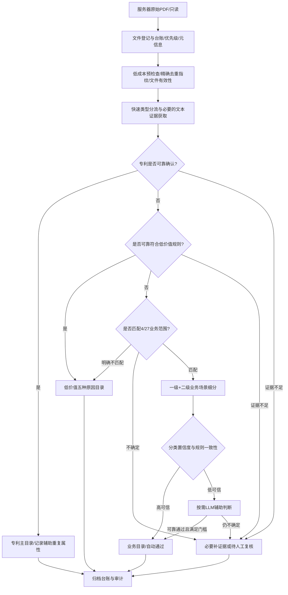

# 900万PDF智能分类与分流归档系统——阶段一业务需求规格说明书

**版本**：V3.0（27场景完整目录与验收强化版）  
**日期**：2026-10-09  
**审查修订**：2026-10-10（就地最小修订，不另立新版文件）  
**目标日期**：2026-12-31  
**用途**：供 Cursor Planner、各开发 Subagent、QA 与业务负责人共同审阅；未确认项不得擅自固化为生产规则。

## 1. 项目目标

对现有服务器约900万份PDF建立可追溯处理台账，按“低成本先行、排除法优先”完成去重、必要内容提取、专利文件识别、低价值文件排除、正常业务文件两级智能分类，并将PDF实体文件**复制至服务器上对应的实际文件目录，校验成功并回写台账**。阶段一不做全量PDF转Markdown，不做全量全文OCR，不对每份文档调用LLM。

### 1.1 唯一主归档目的地

1. **专利目录 `PATENT`**：只要可靠确认属于专利，直接分流，不进入低价值或4/27业务细分。专利即使为重复件也遵守专利优先的主目录规则，重复属性仍保留。
2. **低价值目录 `LOW_VALUE`**：仅对未确认属于专利的文件，若可靠满足低价值排除条件，立即分流，不进入4/27细分。
3. **业务目录 `BUSINESS`**：前两道排除均未命中，且可靠匹配业务范围，归入4个一级类别、27个二级场景中的唯一一对。
4. **待复核暂存区**：任一道关口证据不足或出现冲突，不能可靠定论。它不是业务归档类别，不能冒充已完成分类。归档枚举码与 `contracts/phase1/taxonomy-v3.yaml` 一致，记为 `PENDING`，实体目录为 `04_待复核暂存/`。业务称谓 `PENDING_REVIEW` 与枚举码 `PENDING` 指同一暂存区。对应决策状态为 `NEED_REVIEW`（见阶段一状态机）。本阶段不另设“拒识”业务目录。

归档按唯一主目录落地，同时保留辅助属性、多个命中原因、证据、规则版本和原文件路径。未经批准不删除或覆盖原始PDF。**最终验收必须验证目标目录存在真实PDF实体及其校验结果，只有数据库标签不算归档完成。**

### 1.2 业务分类体系（完整目录清单，强制）

**权威依据**：本次上传的《数据集业务分类信息(1).xlsx》。阶段一只输出“一级分类 + 二级业务场景”，Excel三级分类及数据示例是二级归类的判别证据，并非额外的最终归档层级。

**强制要求：以下27个二级目录必须按原表精确命名、完整创建；不得用“7个二级场景”等占位语句，不得沿用旧版25场景清单。**

| 一级分类 | 二级分类（实体目录名） | 三级业务线索（辅助判断，不新建三级目录） |
|---|---|---|
| 安全生产 | **消防监管** | 防火监督、社会消防 |
| 安全生产 | **矿山监管监察** | 非煤矿山监管监察、煤矿安全监察、矿山安全基础管理 |
| 安全生产 | **危险化学品监管** | 危险化学品安全监管、烟花爆竹安全监管、医药安全监管、化工安全监管 |
| 安全生产 | **石油开采安全监管** | 石油开采安全监管 |
| 安全生产 | **安全生产执法和工贸监管** | 工贸安全监管、安全执法、安全生产标准化、安全考培 |
| 安全生产 | **调查评估和统计** | 事故统计、安全生产执法统计、安全生产信用、安全生产举报 |
| 安全生产 | **安全生产综合协调** | 考核巡查、专项整治、综合监管 |
| 防灾减灾救灾 | **风险监测和综合减灾** | 风险监测、灾害预警、风险评估、综合减灾 |
| 防灾减灾救灾 | **森林草原火灾防治** | 防火督查、森林草原火灾监测预警 |
| 防灾减灾救灾 | **防汛抗旱** | 防汛抗旱 |
| 防灾减灾救灾 | **地质灾害** | 地质灾害 |
| 防灾减灾救灾 | **防震减灾** | 地震监测预报预警、地震探查区划评估、地震科学研究 |
| 防灾减灾救灾 | **救灾和物资保障** | 灾害救助、灾情管理、物资保障 |
| 应急救援 | **指挥调度** | 值班值守、信息接报、会商研判、救援处置、指挥协调 |
| 应急救援 | **救援力量** | 消防救援队伍管理、专业救援力量管理、社会应急力量管理、作战训练 |
| 应急救援 | **预案管理** | 应急预案 |
| 综合管理 | **综合办公** | 公文处理、会议管理、政务公开、信访、档案管理 |
| 综合管理 | **人事管理** | 组织管理、干部管理、干部监督、机构编制、调配劳资、教育人才 |
| 综合管理 | **队伍管理** | 力量建设、队伍机构编制、队伍组织管理、队伍干部管理、队伍招录安置 |
| 综合管理 | **政策法规** | 政策与协调、法律法规、标准、复议应诉 |
| 综合管理 | **国际合作** | 外事管理、国际合作、国际救援 |
| 综合管理 | **规划财务** | 发展规划、财务预算、经济审计、资产管理、专业机构监管 |
| 综合管理 | **新闻宣传** | 新闻报道、宣传教育、舆情信息 |
| 综合管理 | **科技和信息化** | 科技管理、装备保障、信息化项目管理、大数据支撑、卫星和无线通信管理、信息系统运行和网络安全 |
| 综合管理 | **党建管理** | 组织宣传、党风监督、纪律检查、巡视工作、统战群工 |
| 综合管理 | **离退休干部管理** | 离退休干部管理 |
| 综合管理 | **纪检监察** | 纪检监察 |

**分类与归档要求（CAT-001～CAT-009）**

1. **CAT-001**：最终正常业务文件的 `level1` 必须属于以上4个一级分类，`level2` 必须属于该 `level1` 下对应的27场景之一；每份业务文件最终只有一对主分类。
2. **CAT-002**：27个二级目录必须准确建立，目录名称与Excel一致，不允许同义词代替、拼写修改、合并场景或按旧25类生成。
3. **CAT-003**：业务归档路径格式固定为 `03_业务分类/{一级分类}/{二级分类}/{唯一文件名}.pdf`，目录层数只有一级和二级分类；不得将三级业务线索擅自加为目录层级。
4. **CAT-004**：一级、二级均应输出稳定的分类ID；ID映射由正式知识库生成并版本化，不能只靠目录显示名称作为数据库主键。一级ID已冻结：`L1_AQSC` 安全生产、`L1_FZZJ` 防灾减灾救灾、`L1_YJJY` 应急救援、`L1_ZHGL` 综合管理（`contracts/phase1/taxonomy-v3.yaml`，`v3.0-phase1`）。二级在该文件中以Excel目录原名为键。22个名称未变场景的旧ID候选，以及新增「离退休干部管理」「纪检监察」的编码（迁移稿暂记 `L2_LTX`、`L2_JJJC`），以 `docs/design/06_分类体系迁移映射设计.md` 为候选；**新增两项编码待批准（TBD）**。未批准前不得把候选编码写成已冻结主键，也不得用旧25类ID集代表27场景全集。
5. **CAT-005**：三级分类及数据示例用于检索、分类知识库和人工复核证据；同一个二级场景下的三级业务线索应合并服务于该二级的定义，不作为单独终态类别。
6. **CAT-006**：系统必须检查一级—二级父子关系；不匹配不得写入正式业务目录，应记录校验错误并复核/重试。
7. **CAT-007**：专利及低价值排除优先于业务细分；已确认排除文件不得因为与27场景相关而归入业务目录。
8. **CAT-008**：27个目录必须能实际复制进入原始PDF字节文件，且完成文件大小、SHA-256校验后才可标记物理归档成功。
9. **CAT-009**：综合管理及其任一二级场景不得作为无法归类时的兜底。证据不足以确定主责时进入待复核，不得为交出结果而归入综合管理。此条沿用已确认的主责规则，不新增场景。

**分类知识库生成约束**：从Excel读取一级、二级、三级、数据示例四列，先对空白一级/二级单元格进行分组继承，按“一级+二级”去重得到27个唯一场景；不得把三级数据行数误作为二级数量。任何Excel后续变更必须产生新分类版本，并执行目录迁移影响评估。

## 2. 阶段一业务链路



**注意**：图为业务决策顺序，不要求每份PDF都执行所有昂贵步骤；精确哈希和无效检测可先算、先缓存，但最终归档仍须遵守专利优先。对完全不可读文件，不得凭缺失文本认定“不是专利”。

**优先级与判定顺序不是同一步。** 主目录优先级固定为：已确认专利 > 已确认任一低价值（LV01–LV05）> 已确认的4/27业务场景 > 证据不足则待复核。可执行的判定顺序是：专利门 → 不依赖业务相关性的低价值（LV01内容不足、LV02重复件、LV03无效文件、LV05否定词；证据不足不得硬判）→ 相关性门控 → 仅确认属于业务范围后才做27场景细分。图中“明确不匹配”只对应 **LV04 无业务匹配**：文本证据有效，且相关性门控可靠确认不在4/27范围内。低分类得分、证据不足或规则冲突不得走这条边，应进入补证据或待复核。结构损坏、空文件、容器不可恢复属于LV03，该结论不依赖正文层面的“不是专利”。仅文本层缺失、OCR失败或解析超时不得直接记为LV03或LV01，也不得据此排除专利。

## 3. 强制业务规则（已确认）

| ID | 规则 | 行为 |
|---|---|---|
| BR-001 | 专利优先 | 确认专利即进入专利目录并终止下游细分；保留其他属性 |
| BR-002 | 低价值其次 | 非专利文件，确认命中任一低价值规则即进入对应目录 |
| BR-003 | 业务细分最后 | 仅剩余有效且相关文件进入4个一级、27个二级分类 |
| BR-004 | 低成本先行 | 文件元信息、规则、哈希优先于OCR和LLM |
| BR-005 | 按需OCR | 有可用文本层直接提取；图像/混合页仅补必要OCR |
| BR-006 | 控制大模型调用 | 仅疑难件调用有限次LLM，不做900万份全量LLM |
| BR-007 | 置信度分流 | 经真实验证的高可信结果自动通过；低可信交人工兜底 |
| BR-008 | 不可强制归类 | OCR质量差、规则冲突、无明确业务匹配但证据不足时进入待复核 |
| BR-009 | 全程留痕 | 保留原路径、任务ID、判断规则、证据、版本、最终目录与人工修改历史 |
| BR-010 | 阶段一范围 | 不开展全量Markdown转换或全量全文OCR |

## 4. 低价值五种类型

| 规则ID | 目录 | 可自动确认的条件与边界 |
|---|---|---|
| LV01 | `内容不足/` | 经必要的文本抽取和补救后，确实缺少可用业务内容。不能把“OCR失败/解析失败”直接等同内容不足；数值阈值TBD。 |
| LV02 | `重复件/` | 字节级SHA-256相同可确认精确重复；内容近重复需比较业务实体、日期、版本和正文差异，不能仅凭相似分数自动认定。**专利优先于重复件主目录**。 |
| LV03 | `无效文件/` | 经文件有效性检查与有界恢复后确认损坏、空文件或不可处理。临时I/O错误应重试，不当作无效文件。 |
| LV04 | `无业务匹配/` | 文本证据有效且经业务相关性门控可靠确认不属于4/27范围；低分类得分≠可靠无匹配。 |
| LV05 | `命中否定词/` | 命中经业务确认的排除词及**上下文规则、作用范围、例外条件**；不能简单匹配“未”“否”等字词直接排除。正式词表TBD。 |

确认低价值后跳过完整业务细分，但必须保存原因和证据。一个文件可有多个低价值标签，主原因选择规则TBD；任何不确定进入待复核暂存（枚举 `PENDING`）。LV04只由相关性门控的可靠否定产出，不在专利门之前单独硬判。

## 5. 专利业务规则

- 对确认为专利的文件，无论是否属于4/27的业务领域，**主目录始终为`PATENT`**。
- 专利识别优先采用文件名/元数据/首页/专利号/公开号/专利文献结构的低成本多证据判断；需要时逐步扩展文本提取或按需OCR。
- “提到专利”≠“专利文献”；证据不足进入补证或人工复核，不得伪判为非专利。
- 精确重复的专利副本仍进入专利目录，重复关系与主文件关联，不删除副本。
- 专利的具体文献范围（专利申请、授权说明书、证书、专利有关行政文件等）待业务确认。

## 6. 去重与元信息

- 文件登记为所有源文件分配稳定`file_id`；原路径、大小、mtime、哈希、来源批次入台账。
- 三级/四级去重的**业务正式定义尚未提供**；技术建议：路径/元信息预筛、SHA-256精确哈希、清洗正文指纹与近重复核验。应在合同或业务方确认去重等级名称后定稿。
- 精确重复可在正式专利判定前完成哈希计算，但不能提前把可能的专利副本归入低价值；可沿用已确认主件的专利认定证据，版本/证据无法继承则待核验。
- 重复组必须保留主文件ID和全部成员ID，禁止自动删除源PDF。

## 7. 人工复核业务规则

- 触发条件：疑似专利、近重复争议、否定词语境不明、OCR不足、类别候选接近、模型互相矛盾等。
- 复核展示：原始PDF路径/预览、页码证据、模型候选、触发规则、重复主件、建议归档类型。
- 复核动作：确认专利、确认低价值原因、确定一级/二级场景，或退回进一步处理。
- 复核结果写入审计记录，不覆盖原始机器判断；产生新决策版本并触发重新归档。
- 低置信人工兜底为用户确定需求；实际人员容量、SLA和12月底是否必须清零待复核，待业务方确认。

**不设独立拒识终态。** 可靠确认不在4/27范围内，记为低价值LV04，目录 `02_低价值文件/无业务匹配/`。证据不足、规则冲突、OCR质量差、候选接近或模型矛盾，决策状态为 `NEED_REVIEW`，实体进入 `04_待复核暂存/`。旧口径 `IRRELEVANT` 只作为读兼容，语义对应LV04，禁止把低分或未判定写成无关终态。旧口径 `MANUAL_REVIEW` 与 `UNRESOLVED` 在业务上同归这一待复核暂存，不建第二个暂存目录，也不作为业务分类标签；二者在任务/复核轴上的差异由接口与状态机说明。可重试的I/O或解析失败不是复核结论，不得计入已归档。

## 8. 归档目录与成果（正式27场景实体目录）

**以下目录树必须由Archive Worker实际建立，不是数据库中的虚拟标签；二级目录名称以Excel原文为准。**

```text
阶段一分类成果/
├── 01_专利文件/
├── 02_低价值文件/
│   ├── 内容不足/
│   ├── 重复件/
│   ├── 无效文件/
│   ├── 无业务匹配/
│   └── 命中否定词/
├── 03_业务分类/
│   ├── 安全生产/
│   │   ├── 消防监管/
│   │   ├── 矿山监管监察/
│   │   ├── 危险化学品监管/
│   │   ├── 石油开采安全监管/
│   │   ├── 安全生产执法和工贸监管/
│   │   ├── 调查评估和统计/
│   │   └── 安全生产综合协调/
│   ├── 防灾减灾救灾/
│   │   ├── 风险监测和综合减灾/
│   │   ├── 森林草原火灾防治/
│   │   ├── 防汛抗旱/
│   │   ├── 地质灾害/
│   │   ├── 防震减灾/
│   │   └── 救灾和物资保障/
│   ├── 应急救援/
│   │   ├── 指挥调度/
│   │   ├── 救援力量/
│   │   └── 预案管理/
│   └── 综合管理/
│       ├── 综合办公/
│       ├── 人事管理/
│       ├── 队伍管理/
│       ├── 政策法规/
│       ├── 国际合作/
│       ├── 规划财务/
│       ├── 新闻宣传/
│       ├── 科技和信息化/
│       ├── 党建管理/
│       ├── 离退休干部管理/
│       └── 纪检监察/
└── 04_待复核暂存/
```

**实体归档是阶段一硬性要求，不是可选项。** 每个文件最终要落到实际目录下（待人工复核的文件落暂存目录），且目标文件真实存在并可被校验。先在台账中生成目标目录与唯一文件名，再由Archive Worker执行默认复制（不移动、不删除源文件）；采用临时路径写入、字节数及SHA-256校验、同文件系统原子重命名、状态回写。源目录及归档目录必须隔离，避免扫描归档副本形成循环。

## 9. 目标交付与验收

交付内容：全量文件登记台账、去重关系、**实际存有PDF实体的**专利目录、低价值五类目录、4/27场景目录、待复核暂存目录、每份文件决策证据、文件复制校验记录、分类规则及模型版本、复核回流记录、批次进度和错误报告。

**验收指标需要分离。** 下表只定义可观察的核验方法。合格比例、抽检量和截止日期一律TBD，不得用模型相似度代替分类正确概率。目标日期为2026-12-31；真实吞吐、OCR占比、人工量未知，完成可行性须通过真实样本Benchmark证明，本文不承诺吞吐达标。

| 指标 | 怎么核验 | 合格线 |
|---|---|---|
| 登记覆盖率 | 已分配稳定 `file_id` 的PDF数 / 源扫描得到的PDF数 | TBD |
| 成功判定率 | 决策已落到 `APPROVED` 或 `NEED_REVIEW` 的文件数 / 已登记数；处理中与可重试失败不计入已判定 | TBD |
| 自动通过准确率 | 抽检 `APPROVED` 且未经人工改判的样本，主目录与业务金标一致的比例；阈值未校准不得自动通过 | TBD |
| 二级场景准确率 | 抽检 `BUSINESS` 样本，`level2` 与金标及父子关系一致的比例 | TBD |
| 人工复核完成率 | 复核单由 `OPEN` 到 `RESOLVED` 的比例；是否必须在交付日清零见TBD | TBD |
| 归档成功率 | `archive_status=COMPLETED` 且目标PDF存在、字节数与SHA-256均一致的文件数 / 已批准应归档文件数；校验失败不得计入成功 | TBD |

## 10. 待业务方批准事项（TBD）

1. 专利文献范围（申请、授权说明书、证书、行政文件等是否都算专利）。精确重复的专利副本主目录已定为专利目录，且不得删除副本；未确认的是近重复专利是否各自落盘。
2. LV01内容不足阈值和例外；LV03无效文件范围。
3. LV05正式否定词表、作用范围、例外和冲突优先级。
4. 近重复相似度与关键实体/版本差异判据，以及所谓三级/四级去重的正式口径。
5. 低价值多原因命中时的主目录优先级。
6. 人工复核人员、速度、截止日待复核余额上限。
7. 归档根路径的具体挂载位置、唯一文件名算法，以及是否允许硬链接。复制而非移动、源只读且禁止删除或覆盖、业务路径 `03_业务分类/{一级分类}/{二级分类}/`、临时文件写入后做大小与 SHA-256 校验再原子重命名，已由第8节和 AR-001～AR-010 确认，不在本项待定范围内。
8. 自动通过阈值、验证样本及目标准确率。
9. 归档存储容量、磁盘配额、跨盘复制带宽的具体数值。源目录与归档目录必须隔离已由第8节确认；具体挂载位置与文件名算法见第7项。

未确认的TBD规则应配置为保守模式（补证据/待人工复核），不能让Cursor写死未经批准的数字或默认自动排除。

## 11. 强制物理归档需求（新增，优先级最高）

| 规则ID | 必须满足的业务行为 | 验收方式 |
|---|---|---|
| AR-001 | 将每份已确认结果的PDF原始字节复制到唯一的正确目标目录，目录为实体文件夹 | 在文件系统检查路径和文件实体 |
| AR-002 | 归档根路径`ARCHIVE_ROOT`可配置，且位于扫描源范围外；根目录下专利、低价值5子目录、4/27业务目录、待复核目录实际创建 | 实际目录树核验 |
| AR-003 | 已确认专利直接写入专利目录并停止低价值及业务细分 | 专利与重复件、专利与否定词冲突用例 |
| AR-004 | 已确认低价值直接写入对应低价值子目录，并跳过业务细分 | 五种低价值原因完整用例 |
| AR-005 | 剩余业务文件仅在一级/二级结果经确认后写入相应27场景文件夹 | 一级-二级目录准确性抽样 |
| AR-006 | 原始PDF只读，默认复制而非移动；禁止覆盖源文件和未授权删除 | 原件前后校验/权限检查 |
| AR-007 | 复制后验证文件大小及SHA-256，校验失败不得标记COMPLETED | 注入截断/损坏故障 |
| AR-008 | 文件名唯一且安全，可追溯源文件；防路径穿越、覆盖、循环扫描 | 同名、恶意路径、重复投递测试 |
| AR-009 | 归档失败必须有重试及错误台账；中断恢复不得重复生成副本 | 磁盘满、崩溃、Redis重投测试 |
| AR-010 | 人工复核修改分类后，实体归档路径同步变更并留痕，禁止残留多份正式主归档副本 | 复核重归档集成测试 |

### 11.1 文件归档完成标准

**已分类**与**已归档**是两个不同事实：`decision_status=APPROVED`仅表示逻辑决策完成，`archive_status=COMPLETED`必须同时满足目标目录真实存在、目标PDF真实存在、字节数一致、SHA-256一致、数据库完成时间与目标路径落库。人工待复核文件的暂存复制也必须有独立的`staging_status`，不可被统计为业务正式归档。

### 11.2 容量与周期约束

归档副本原则上会占用近似源PDF总量的额外存储空间，另需临时复制和重试空间；不得仅按900万文件数量估算磁盘容量。批处理必须统计`source_total_bytes`、`archived_bytes`、`remaining_bytes`、`copy_throughput_MBps`和复制失败率，并以实际磁盘/网络基准验证12月31日交付风险。

## 12. 27场景分类和实体归档专项验收

| 验收编号 | 场景 | 通过条件 |
|---|---|---|
| AT-CAT-01 | 分类目录数量 | 4个一级目录，二级目录合计严格27个，分别7/6/3/11 |
| AT-CAT-02 | 名称核对 | 27个二级目录逐一与Excel原表一致，无缺失、重名、旧25场景残留 |
| AT-CAT-03 | 父子关系 | 所有已归档BUSINESS记录的level2属于相应level1，非法组合100%被阻断 |
| AT-CAT-04 | 目录落盘 | 逐一向27个场景目录放入测试PDF，实际文件存在并通过哈希校验 |
| AT-CAT-05 | 专利优先 | 同时命中专利和普通业务/重复条件时，确定的专利仍归专利目录，记录辅助标记 |
| AT-CAT-06 | 低价值优先 | 五种低价值原因均有正反例，确认排除文件不进入业务27场景 |
| AT-CAT-07 | 三级证据 | 三级分类与数据示例进入知识库，但系统不产生第三级实体归档目录 |
| AT-CAT-08 | 复核与更正 | 低置信记录进入待复核；复核后按新的二级目录重新实体归档且保留审计记录 |
| AT-CAT-09 | 版本一致 | 输出台账包含taxonomy_version、原始路径、分类ID、目录及拷贝校验状态 |

**重要边界**：具体否定词、内容不足阈值、专利范围、近重复阈值仍由业务方确认。本版新增的27场景名称及三级业务证据来自Excel，不代表上述待确认规则已经审批。
